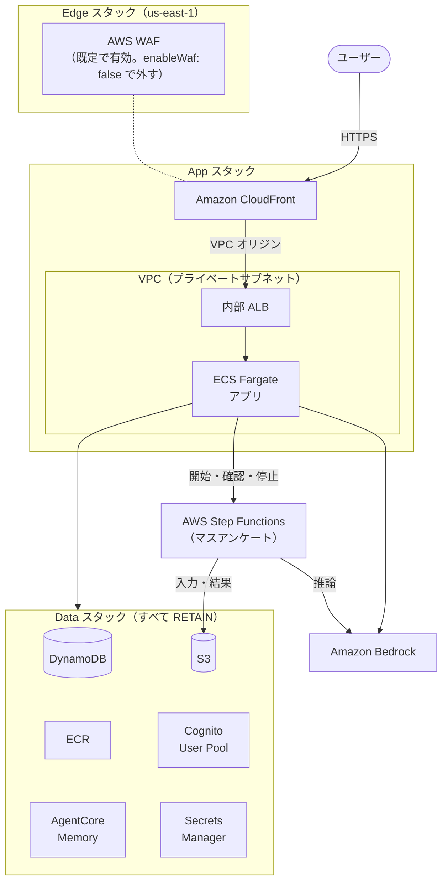

# AI ペルソナシステムの AWS CDK デプロイについて

AI ペルソナシステムを AWS にデプロイするための CDK コードです。v1.0.0 では、ログインをアプリ自身が行い、アプリを ECS Fargate と内部 ALB で動かし、CDK を Data・App・Edge の 3 スタックで構成。

インターネットへ出る経路を持たない VPC で動かす場合は、[閉域構成ガイド](../docs/closed_network.md) を参照してください。

## AI ペルソナシステム（v1） の構成



利用者は CloudFront から内部 ALB を経てアプリへ届きます。WAF は既定で有効で、Edge スタック（us-east-1）に WebACL を作り、CloudFront に関連付けます。アプリは Cognito Managed Login でログインさせ、ログインセッションを DynamoDB に置きます。マスアンケートは、アプリが Step Functions の実行を始め、ペルソナごとの推論と S3 の入力・結果の読み書きは Step Functions が行います。

| スタック（Stage `AIPersonaDev`） | リージョン | 中身 |
|---|---|---|
| `AIPersonaDev-Data` | ap-northeast-1 | DynamoDB、S3、ECR、Cognito User Pool、AgentCore Memory、KMS キー、Secrets Manager の鍵 |
| `AIPersonaDev-Edge` | us-east-1 | CloudFront 用の WAF（`enableWaf: true` のときだけ。既定は有効） |
| `AIPersonaDev-App` | ap-northeast-1 | VPC、内部 ALB、ECS Fargate、CloudFront、Cognito のアプリクライアント、マスアンケートの Step Functions のステートマシン、ログ |

## デプロイ

デプロイの方法は 2 つあります。

| 方法 | 向いているケース | 前提条件 |
|---|---|---|
| **A. CloudShell でスクリプトを実行する（推奨）** | すぐにデプロイしたい。B の前提条件の環境がない。 | AWS マネジメントコンソールにサインイン可能 |
| **B. 手元の端末で `cdk deploy` を 1 段ずつ実行する** | ローカルPCからデプロイしたい。パラメータやコードをカスタマイズしたい。 | AWS CLI v2、Node.js 22、Docker、Git、デプロイ先の AWS アカウントの資格情報 |

方法 A の `deploy.sh` は、方法 B の手順を順に自動で実行するスクリプトです。

どちらの方法でも、デプロイは次の順に進みます。

1. **準備**: CDK の bootstrap（アカウントとリージョンごとに初回だけ）
2. **Data・Edge スタック**: テーブル・ECR・Cognito などの状態を持つリソースと、CloudFront 用の WAF（us-east-1）を作る
3. **コンテナイメージ**: アプリのイメージをビルドして ECR へ送る（タグは Git のコミットの短いハッシュ）
4. **App スタック**: 3 のイメージで、VPC・ALB・ECS Fargate・CloudFront を作る

### 設定（`cdk/parameters.ts`）

機能の切り替えは `cdk/parameters.ts` で行います。既定のままでも動きます。変えるときは、ファイルを編集してそのままデプロイできます。

| 項目 | 既定 | 説明 |
|---|---|---|
| `appDesiredCount` | 1 | タスクの台数（1〜10） |
| `enableWaf` / `allowedIpAddresses` | `true` / なし | CloudFront 用 WAF と IP 制限。ログイン画面への短時間の大量アクセスも止める。費用を抑えるなら `false` にする（月 $8 ほど減る） |
| `enableAdditionalPersonaModels` | `false` | 追加ペルソナベースモデル（Bedrock Mantle 経由） |
| `enableDatasetAnalysis` | `true` | データセット構造化分析ツール |
| `dataAgentRuntimeArn` / `dataAgentRegion` | なし | データ分析エージェント連携 |
| `inferenceScope` | `global` | 推論の範囲（下の「[推論の範囲](#推論の範囲inferencescope)」） |
| `surveyModelId` | 範囲の既定（Claude Haiku 5.5） | マスアンケートのモデル。`global.` か `jp.` の推論プロファイル ID |
| `surveyMaxConcurrency` | 64 | マスアンケート 1 件の実行で同時に呼ぶ推論の数（1〜1000）。下の「[マスアンケートの並列数と打ち切り時間](#マスアンケートの並列数と打ち切り時間)」 |
| `surveyExecutionTimeoutSeconds` | 7200 | マスアンケート 1 件の実行の打ち切り時間（秒、600〜86400） |
| `enableMcpGateway` | `false` | MCP Gateway は後続リリースで提供します。v1.0.0 では `true` にできません |

### 方法 A: CloudShell でスクリプトを実行する（推奨）

1. AWS マネジメントコンソールにサインインし、CloudShell を開きます(デフォルト：東京（ap-northeast-1）にして)
2. 次を実行します

   ```bash
   git clone https://github.com/aws-samples/sample-ai-persona.git
   cd sample-ai-persona
   ./deploy.sh
   ```

3. 終わると、アプリの URL と、最初の admin を作るコマンドが表示されます。続けて「[デプロイ後: 最初の admin を作る](#デプロイ後-最初の-admin-を作る)」へ進みます

必要に応じて、次のオプションを付けます。

| オプション | 説明 |
|---|---|
| `--region <リージョン>` | 東京（ap-northeast-1）以外にデプロイする（Edge は us-east-1） |
| `--inference-scope jp` | 推論を国内に限る（下の「[推論の範囲](#推論の範囲inferencescope)」） |
| `--image-tag <タグ>` | 前の版に戻す（下の「[前の版に戻す](#前の版に戻す)」） |
| `--restart-app` | Secrets Manager の秘密の値を書き換えたあとに、タスクを入れ替える |

### 方法 B: 手元の端末で `cdk deploy` を実行する

始める前に、次を確かめます。

- AWS CLI v2、Node.js 22、Docker、Git が使える
- デプロイ先の AWS アカウントの資格情報が設定されている（`aws sts get-caller-identity` でアカウント ID が出る）
- リポジトリを取得している。アプリのコードを変えたときはコミットしてある（イメージのタグにコミットの短いハッシュを使うため。`cdk/parameters.ts` の変更はコミット不要）

以下のコマンドは、すべてリポジトリのルートで、同じターミナルで続けて実行します。

**ステップ 1. 準備**

```bash
export REGION=ap-northeast-1
export ACCOUNT_ID=$(aws sts get-caller-identity --query Account --output text)
export IMAGE_TAG=$(git rev-parse --short HEAD)

cd cdk
npm ci
npx cdk bootstrap aws://${ACCOUNT_ID}/${REGION} --region ${REGION}
npx cdk bootstrap aws://${ACCOUNT_ID}/us-east-1 --region us-east-1   # Edge（WAF）用
```

bootstrap は、アカウントとリージョンごとに初回だけ必要です。

**ステップ 2. Data・Edge スタック**

```bash
npx cdk deploy AIPersonaDev/Data AIPersonaDev/Edge -c region=${REGION} -c imageTag=${IMAGE_TAG}
```

IAM やセキュリティグループの変更について確認を求められたら、内容を確かめて `y` を入力します。

**ステップ 3. コンテナイメージ**

```bash
cd ..
ECR_URI=$(aws cloudformation describe-stacks --stack-name AIPersonaDev-Data --region ${REGION} \
  --query "Stacks[0].Outputs[?OutputKey=='EcrRepositoryUri'].OutputValue" --output text)

aws ecr get-login-password --region ${REGION} | \
  docker login --username AWS --password-stdin ${ECR_URI%%/*}
docker build --platform linux/amd64 -t ${ECR_URI}:${IMAGE_TAG} .
docker push ${ECR_URI}:${IMAGE_TAG}
```

- アプリは x86_64（`linux/amd64`）で動きます。ビルドは x86_64 の端末か CloudShell で行ってください。Apple シリコンの Mac で `--platform linux/amd64` を付けてビルドすると、エミュレーションのため DuckDB の拡張を入れる手順で失敗します
- ECR のタグは上書きできません。同じタグのイメージを送信済みのとき（コードを変えずに再デプロイするときなど）は、このステップを飛ばして構いません

**ステップ 4. App スタック**

```bash
cd cdk
npx cdk deploy AIPersonaDev/App -c region=${REGION} -c imageTag=${IMAGE_TAG}
```

> **`-c imageTag` を必ず付けてください。** 付け忘れると、App は存在しないイメージ（タグ `unset`）を使い、アプリが起動しません。

**ステップ 5. アプリの URL を確かめる**

```bash
aws cloudformation describe-stacks --stack-name AIPersonaDev-App --region ${REGION} \
  --query "Stacks[0].Outputs[?OutputKey=='AppUrl'].OutputValue" --output text
```

続けて「[デプロイ後: 最初の admin を作る](#デプロイ後-最初の-admin-を作る)」へ進みます。

**閉域構成を方法 B でデプロイするとき**

- Stage は `AIPersonaDevClosed` です。Edge スタックはなく、us-east-1 の bootstrap も要りません。ステップ 2 は `AIPersonaDevClosed/Data` だけ、ステップ 4 は `AIPersonaDevClosed/App` をデプロイし、ステップ 3・5 のスタック名も `AIPersonaDevClosed-Data`・`AIPersonaDevClosed-App` に読み替えます
- ステップ 2 と 4 に、閉域のコンテキストを毎回同じ値で付けます。必須は `-c closedCertificateArn=<ARN> -c closedDomainName=<FQDN>` と、`-c closedAllowedCidrs=<CIDR,...>` か `-c closedCreateTestEnvironment=true` の少なくとも一方です。必要に応じて `-c closedEndpointAzCount=<1|2>`、`-c closedCreateResolverEndpoint=true -c closedResolverAllowedCidrs=<CIDR,...>`、`-c closedInferenceScope=jp` を付けます
- 再デプロイで付け忘れると、検証用 EC2・許可した CIDR・Resolver が消えます（[閉域構成ガイドの「再デプロイの注意」](../docs/closed_network.md#再デプロイの注意)）

### デプロイ後: 最初の admin を作る

動作確認用の admin を 1 人作ります。方法 A では、`deploy.sh` の最後に、値を埋めたこのコマンドが表示されます。

```bash
USER_POOL_ID=$(aws cloudformation describe-stacks --stack-name AIPersonaDev-Data --region ${REGION:-ap-northeast-1} \
  --query "Stacks[0].Outputs[?OutputKey=='UserPoolId'].OutputValue" --output text)

aws cognito-idp admin-create-user --region ${REGION:-ap-northeast-1} \
  --user-pool-id ${USER_POOL_ID} --username <メールアドレス> \
  --user-attributes Name=email,Value=<メールアドレス> Name=email_verified,Value=true
aws cognito-idp admin-add-user-to-group --region ${REGION:-ap-northeast-1} \
  --user-pool-id ${USER_POOL_ID} --username <メールアドレス> --group-name role:admin
```

仮のパスワードがメールで届きます。アプリの URL を開いてログインし、新しいパスワードを設定できれば、デプロイは完了です（`<アプリの URL>/health` でも応答を確かめられます）。

ほかの利用者の追加、ロールの付け方、グループの作り方は [利用者・ロール・グループの管理](../docs/user_management.md) を参照してください。

## 更新と切り戻し

### 更新時の再デプロイ

最新のコードを取り込み（`git pull`）、もう一度デプロイします。アプリのコードを自分で変えたときは、先にコミットしておきます。

- **方法 A**: `./deploy.sh` を実行します。コードが変わっていなければ、イメージは送り直しません
- **方法 B**: ステップ 1 の変数を設定し直し（bootstrap は不要）、ステップ 2〜4 を実行します

CDK を変えたときは、デプロイの前にローカルの検査（`uv run pytest -q`、`uv run ruff check .`、`uv run mypy src/ web/`、`cd cdk && npx tsc --noEmit && npm test && npx cdk synth --no-staging`）を通し、差分を確かめます。テーブル・バケット・User Pool が置き換わる差分（同じ論理 ID の `[-]` と `[+]`）があれば止めてください。

```bash
cd cdk && npx cdk diff 'AIPersonaDev/*' -c imageTag=$(git rev-parse --short HEAD)
```

### 前の版に戻す

戻すのは **アプリのイメージだけ** です。CDK は今のコミットのまま、ECR にある前のイメージのタグを渡します。

- **方法 A**: `./deploy.sh --image-tag <前のタグ>`
- **方法 B**: ステップ 4 だけを `-c imageTag=<前のタグ>` で実行します

注意:

- **CDK を前のコミットに戻してデプロイしないでください。** Data スタックの形が前に戻り、追加したテーブルやインデックスがスタックから外れて、保存したデータが見えなくなります
- 新しいタスクが起動に失敗したときは、ECS が自動で前の版に戻すため、手で戻す必要はありません
- 前の版のアプリは、新しい版で増えたデータ（議論の発言、カスタムデータの利用範囲など）を読まないことがあります。もう一度新しい版のイメージでデプロイすれば元どおり見えます

## 環境の削除

削除の方法もデプロイと同じく 2 つあります。

| 方法 | 内容 |
|---|---|
| **A. スクリプトで削除する（推奨）** | `./destroy.sh` で、スタックを依存の逆順に削除します。データも消すときは、続けて `./scripts/purge-retained.sh` を実行します |
| **B. `cdk destroy` で削除する** | 手元の端末から CDK でスタックを削除します。データは方法 A と同じく `./scripts/purge-retained.sh` で削除できます |

### 削除の前に: データは既定で残ります

データを守るため、次のリソースは RETAIN になっていて、スタックを消しても AWS に残ります。

| スタック | 残るリソース |
|---|---|
| `AIPersonaDev-Data` | DynamoDB のテーブル、KMS キー（セッションのテーブルの暗号化）、S3 のアップロード用バケット、Cognito User Pool、ECR のリポジトリ、AgentCore Memory、Secrets Manager の鍵 |
| `AIPersonaDev-App` | アプリとマスアンケートのロググループ、Step Functions のステートマシン、Cognito のアプリクライアントの秘密 |

- 残ったリソースは課金が続きます（DynamoDB・S3 の保存量、ECR のイメージ、KMS キー、Secrets Manager の秘密など）
- 再デプロイすると新しいリソースが作られます。残ったリソースのデータは引き継がれません
- 閉域構成（`AIPersonaDevClosed-Data`・`AIPersonaDevClosed-App`）でも、残るリソースは同じです

### 方法 A: スクリプトで削除する（推奨）

CloudShell（または方法 B の前提をそろえた端末）で、リポジトリのルートから実行します。

**ステップ 1. スタックを削除する**

```bash
./destroy.sh
```

1. 削除するスタックの一覧が表示されます。`yes` と入力すると、App → Edge（us-east-1）→ Data の順に削除します
2. 終わると、削除したスタックと、残っているリソースの一覧が表示されます

| オプション | 説明 |
|---|---|
| `--closed` | 閉域構成（`AIPersonaDevClosed`）を削除する（[閉域構成ガイド](../docs/closed_network.md#環境の削除)） |
| `--region <リージョン>` | 東京以外にデプロイしたとき。デプロイと同じ値にする |
| `--force` | スタック削除の確認を省く |

**ステップ 2. データも消すとき**

```bash
./scripts/purge-retained.sh
```

1. 削除済みのスタックから残っているリソースを探し、一覧を表示します。Stage 名（`AIPersonaDev`）の入力を求められ、一致しなければ何も削除せずに終わります
2. 一致すると、一覧のリソースを削除します。元に戻せません

オプションは `--closed` と `--region <リージョン>`（ステップ 1 と同じ値にする）です。Stage 名の確認は省けません。

- 対象は、Stage のスタックのうち削除から 90 日以内のもので、RETAIN で残ったリソースです。CloudFormation が削除済みのスタックの記録を返すのが 90 日間のためです。過去に削除してデータを残した分も一緒に対象になります
- Stage のスタックが 1 つでも残っているときは、何もせずに終わります（動いている環境のデータは消しません）
- すでに消えたリソースは飛ばします。途中でセッションが切れても、同じコマンドを再実行すれば続きから削除します
- Secrets Manager の秘密は、削除後 7 日間は復元できます。KMS キーは最後に削除を予約し、7 日後に消えます（それまでは取り消せます）。それ以外は元に戻せません
- 一部のデータの削除に失敗しても、残りは削除を続けます。失敗したものは最後に一覧で表示します

### 方法 B: `cdk destroy` で削除する

方法 B の前提をそろえた端末で、リポジトリのルートから実行します。

**ステップ 1. 残るリソースを控える**

スタックを消すと、どのリソースがこの環境のものか分かりにくくなるため、先に一覧を保存します。

```bash
export REGION=ap-northeast-1
for stack in AIPersonaDev-Data AIPersonaDev-App; do
  aws cloudformation describe-stack-resources --stack-name ${stack} --region ${REGION} \
    --query "StackResources[].[ResourceType,PhysicalResourceId]" --output text
done > ~/retained-resources.txt   # 作業ツリーの外に置く
```

**ステップ 2. スタックを削除する**

```bash
cd cdk
npx cdk destroy 'AIPersonaDev/*' -c region=${REGION}
```

確認で `y` を入力すると、CDK が依存の逆順（App → Edge → Data）で削除します。

閉域構成のときは `'AIPersonaDevClosed/*'` を指定し、デプロイと同じ閉域のコンテキスト（`-c closedCertificateArn=<ARN> -c closedDomainName=<FQDN>` と、`-c closedAllowedCidrs=<CIDR,...>` か `-c closedCreateTestEnvironment=true`）を付けます。付けないと、削除するスタックが見つかりません。

**ステップ 3. データも消すとき**

方法 A のステップ 2 と同じく `./scripts/purge-retained.sh` で削除できます（削除済みのスタックから対象を探します）。手で消すときは、ステップ 1 で控えた一覧のうち、[残るリソース](#削除の前に-データは既定で残ります)の表にあるものを、コンソールか CLI で削除します。DynamoDB のテーブルと Cognito User Pool は削除保護を外してから、S3 のバケットは全バージョンを消してから削除し、KMS キーはテーブルを消したあとに削除を予約します。

### v0 の環境を削除する

v1.0.0 より前の `deploy.sh` で作ったスタック（`AIPersona-dev`、`AIPersonaEcr-dev`、`AIPersonaCognito-dev` など）は、上の方法では削除されません。v0 は v1 からの切り戻しのために残しておけます。v0 のデータを v1 へ移す手順は [移行ガイド](../docs/migration_v0_to_v1.md) を参照してください。v0 の dev 環境はスタックを削除するとデータも消えるため、移行と確認が終わってから、次のスクリプトで削除します。

```bash
./scripts/destroy-v0.sh [--env dev] [--region us-east-1]
```

v0 を削除すると、v1 から v0 へは切り戻せなくなります。

## 推論の範囲（`inferenceScope`）

Bedrock の推論を送ってよい範囲を `global`（既定）か `jp`（国内）から選びます。公開・閉域のどちらの構成でも使えます。範囲に合わせて、既定のモデル・選べるモデル・IAM の権限がまとめて変わります。

| | `global`（既定） | `jp` |
|---|---|---|
| ペルソナ生成・インサイト・レポート | Claude Sonnet 5.5 | Claude Haiku 5.5 |
| 議論・インタビューの既定 | Claude Haiku 5.5 | Claude Haiku 5.5 |
| マスアンケート | Claude Haiku 5.5 | Claude Haiku 5.5 |
| 議論・インタビューで選べるモデル | Claude Haiku 5.5、Claude Haiku 4.5、Claude Sonnet 5.5、Claude Sonnet 5、追加のモデル（有効なときだけ） | Claude Haiku 5.5、Claude Haiku 4.5 |

指定のしかた:

- `parameters.ts` の `devParameter`（閉域は `closedDevParameter`）の `inferenceScope: 'jp'` に変更
- `./deploy.sh --inference-scope jp`。次の再デプロイで付け忘れると `global` に戻ります

制約:

- `jp` は、リージョンが `ap-northeast-1` か `ap-northeast-3` のときだけ使えます
- `jp` と追加のモデル（`enableAdditionalPersonaModels: true`）は同時に使えません。追加のモデルは米国のリージョンを呼ぶためです
- 範囲を変えても、保存済みのペルソナのモデル設定は書き換えません。アプリが呼ぶときに、範囲の中の同じモデルに読み替えます

## マスアンケートの並列数と打ち切り時間

マスアンケートは Step Functions のステートマシン（Distributed Map、子の実行は Express）で、ペルソナごとに Bedrock の推論を呼びます。アプリ（Web タスクの進行役）は待ちのアンケートを 1 件ずつ実行に渡し、終わったら次を始めます。

1 件の所要時間は並列数にほぼ反比例します。10,000 件のアンケートの目安は次のとおりです（dev の試験の 1,000 件 73 秒から見積もった値。モデルの応答時間とスロットリングで変わります）。

| `surveyMaxConcurrency` | 10,000 件の所要時間の目安 | 合わせる `surveyExecutionTimeoutSeconds` |
|---|---|---|
| 64（既定） | 約 12 分 | 7200（既定）で足りる |
| 16 | 約 48 分 | 7200（既定）で足りる |
| 8 | 約 96 分 | 7200 では余裕が少ないため 10800 以上 |

- 並列数を上げると、同じモデルを使う議論・インタビューのスロットリングが増えることがあります。上げるときは Bedrock のクォータ（`EstimatedTPMQuotaUsage`・`InvocationThrottles`）を確かめてください
- 打ち切り時間を過ぎた実行は Step Functions が止め、アプリはアンケートをエラー（制限時間内に終わらなかった）にします。アプリにも同じ値を渡します（`SURVEY_EXECUTION_TIMEOUT_SECONDS`）
- 実行の入力と結果は、アップロード用バケットの `survey-runs/` に置き、7 日で消えます（古いバージョンは 1 日）

## 運用（管理者向け）

### テーブルを PITR で戻す

1. 戻したいテーブル（例: `Personas`）を、PITR で **新しいテーブル** に復元する（元のテーブルは消さない）

   ```bash
   aws dynamodb restore-table-to-point-in-time \
     --source-table-name <Personas の物理名> \
     --target-table-name <Personas の物理名>-restore-<日時> \
     --restore-date-time <ISO 8601 の時刻>
   ```

2. 復元したテーブルの項目を、元のテーブルへ書き戻す（`aws dynamodb scan` で読み、`batch-write-item` で書く）
3. 上の「共有の索引の作り直し」を流す
4. 復元に使った新しいテーブルを手で消す（元のテーブルではないことを確かめてから）

### 誤って消したファイルを戻す

アップロード用のバケットはバージョニングを有効にしているため、アプリが消したファイル（アバターなど）は古いバージョンとして 7 日間残ります。7 日以内なら、S3 のコンソールか CLI で古いバージョンを取り出せます。

### トークンの暗号化鍵の入れ替え

Secrets Manager の `TokenEncryptionKeys`（`{"current": "v1", "k_v1": "..."}`）を手で書き換え、そのたびに `./deploy.sh --restart-app` でタスクを入れ替えます。

1. 新しい版（例: `"k_v2": "<64 文字の乱数>"`）を足し、`--restart-app`
2. すべてのタスクが入れ替わったら `current` を新しい版にして、`--restart-app`
3. 7 日後（セッションの最長）に古い版を外して、`--restart-app`

### 「ログインできない、403 が出る」と言われたら

WAF が有効（既定）だと、ログイン画面へ同じ IP から 5 分に 100 件を超える要求があったときに 403 で止めます。us-east-1 の WAF のコンソールで WebACL `ai-persona-v1-waf-<env>` の「Sampled requests」を開き、ルール `LoginRateLimit` で止めた送り元を確かめます。出口の IP を多くの人で共有する組織で正当な利用者が止まっているなら、`cdk/lib/edge-stack.ts` の閾値を上げて Edge スタックをデプロイし直します（`cd cdk && npx cdk deploy AIPersonaDev/Edge`）。

## 手元の開発

手元では `AUTH_MODE=local` で起動します（Cognito などを使わず、設定した開発用の利用者でログインする）。詳しくは [ローカル開発ガイド](../docs/local_development.md) を参照してください。
