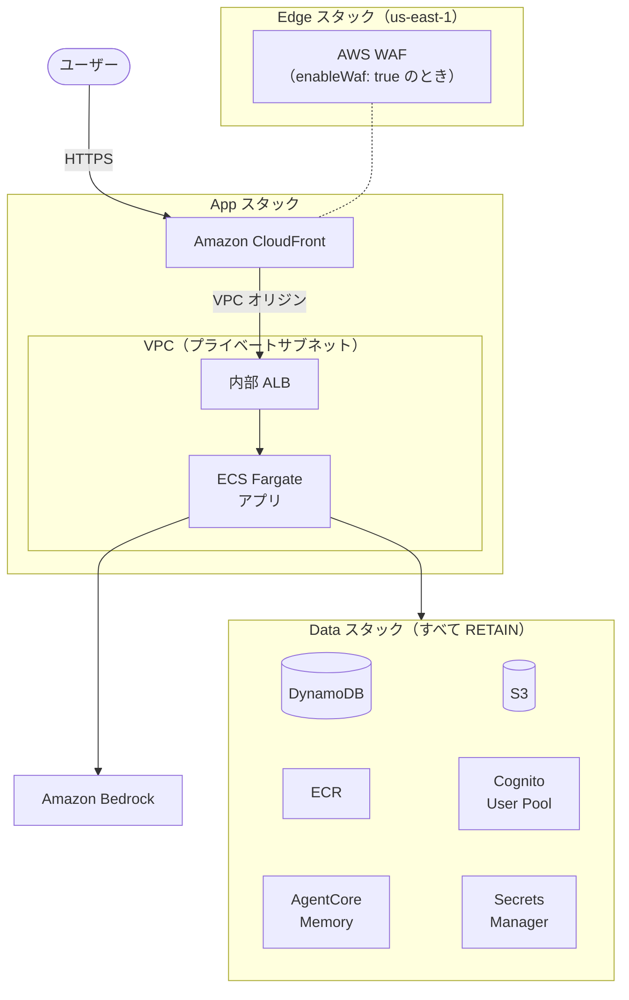

# AI ペルソナシステムの AWS CDK デプロイについて

AI ペルソナシステムを AWS にデプロイするための CDK コードです。v1.0.0 では、ログインをアプリ自身が行い、アプリを ECS Fargate と内部 ALB で動かし、CDK を Data・App・Edge の 3 スタックで構成。

インターネットへ出る経路を持たない VPC で動かす場合は、[閉域構成ガイド](../docs/closed_network.md) を参照してください。

## AI ペルソナシステム（v1） の構成



利用者は CloudFront から内部 ALB を経てアプリへ届きます。WAF を有効にすると、Edge スタック（us-east-1）に WebACL を作り、CloudFront に関連付けます。アプリは Cognito Managed Login でログインさせ、ログインセッションを DynamoDB に置きます。状態を持つもの（テーブル、S3、ECR、User Pool、AgentCore Memory、鍵）は Data スタックにあり、すべて RETAIN です。App スタックは壊して作り直せます。

| スタック（Stage `AIPersonaDev`） | リージョン | 中身 |
|---|---|---|
| `AIPersonaDev-Data` | ap-northeast-1 | DynamoDB、S3、ECR、Cognito User Pool、AgentCore Memory、KMS キー、Secrets Manager の鍵 |
| `AIPersonaDev-Edge` | us-east-1 | CloudFront 用の WAF（`enableWaf: true` のときだけ） |
| `AIPersonaDev-App` | ap-northeast-1 | VPC、内部 ALB、ECS Fargate、CloudFront、Cognito のアプリクライアント、ログ |

## デプロイ（CloudShell）

前提: CloudShellで、作業ツリーに未コミットの変更がないこと（イメージのタグに Git のコミットの短いハッシュを使うため）。

```bash
git clone https://github.com/aws-samples/sample-ai-persona.git
cd sample-ai-persona
./deploy.sh
```

`deploy.sh` は、CDK の bootstrap、Data・Edge スタックのデプロイ、コンテナイメージのビルドと ECR への送信、App スタックのデプロイを順に行い、最後にアプリの URL と最初の admin を作るコマンドを表示します。ID を手で書き写す手順はありません。

| オプション | 使いどころ |
|---|---|
| `--image-tag <タグ>` | 前の版に戻すとき（下の「[前の版に戻す](#前の版に戻す)」） |
| `--restart-app` | Secrets Manager の秘密の値を書き換えたあと。タスクを入れ替える |
| `--region <リージョン>` | Data・App のリージョン（既定 ap-northeast-1。Edge は常に us-east-1） |
| `--inference-scope jp` | 推論を国内に限る（下の「[推論の範囲](#推論の範囲inferencescope)」） |

### 最初の admin を作る

`deploy.sh` の最後に表示されるコマンドで、利用者を作って `role:admin` のグループに入れます。仮のパスワードがメールで届き、初回ログインで新しいパスワードを設定します。

ほかの利用者の追加、ロールの付け方、グループの作り方は [利用者・ロール・グループの管理](../docs/user_management.md) を参照してください。

### 設定（`cdk/parameters.ts`）

v1.0.0 では `deploy.sh` のオプションで機能を切り替えません。`cdk/parameters.ts` を編集してコミットしてから `./deploy.sh` を実行します。

| 項目 | 既定 | 説明 |
|---|---|---|
| `appDesiredCount` | 1 | タスクの台数（1〜10） |
| `enableWaf` / `allowedIpAddresses` | `false` / なし | CloudFront 用 WAF と IP 制限。有効にすると、ログイン画面への短時間の大量アクセスも止める |
| `enableAdditionalPersonaModels` | `false` | 追加ペルソナベースモデル（Bedrock Mantle 経由） |
| `enableDatasetAnalysis` | `true` | データセット構造化分析ツール |
| `dataAgentRuntimeArn` / `dataAgentRegion` | なし | データ分析エージェント連携 |
| `inferenceScope` | `global` | 推論の範囲（下の「[推論の範囲](#推論の範囲inferencescope)」） |
| `enableMcpGateway` | `false` | MCP Gateway は後続リリースで提供します。v1.0.0 では `true` にできません |

### 更新時の再デプロイ

最新のコードを取り込んで（コミットされた状態で）`./deploy.sh` を実行します。コードが変わっていなければイメージは送り直しません。

CDK を変えたときは、デプロイの前にローカルの検査（`uv run pytest -q`、`uv run ruff check .`、`uv run mypy src/ web/`、`cd cdk && npx tsc --noEmit && npm test && npx cdk synth --no-staging`）を通し、差分を確かめます。テーブル・バケット・User Pool が置き換わる差分（同じ論理 ID の `[-]` と `[+]`）があれば止めてください。

```bash
cd cdk && npx cdk diff 'AIPersonaDev/*' -c imageTag=$(git rev-parse --short HEAD)
```

### 前の版に戻す

戻すのは **アプリのイメージだけ** です。CDK は今のコミットのまま、前のイメージのタグを渡します。

```bash
./deploy.sh --image-tag <前のタグ>
```

- **CDK を前のコミットに戻して `./deploy.sh` を流さないでください。** Data スタックの形が前に戻り、追加したテーブルやインデックスがスタックから外れて、保存したデータが見えなくなります
- 新しいタスクが起動に失敗したときは、ECS が自動で前の版に戻すため、手で戻す必要はありません
- 前の版のアプリは、新しい版で増えたデータ（議論の発言、カスタムデータの利用範囲など）を読まないことがあります。もう一度新しい版のイメージでデプロイすれば元どおり見えます

## 推論の範囲（`inferenceScope`）

Bedrock の推論を送ってよい範囲を `global`（既定）か `jp`（国内）から選びます。公開・閉域のどちらの構成でも使えます。範囲に合わせて、既定のモデル・選べるモデル・IAM の権限がまとめて変わります。

| | `global`（既定） | `jp` |
|---|---|---|
| ペルソナ生成・インサイト・レポート | Claude Sonnet 5 | Claude Haiku 5.5 |
| 議論・インタビューの既定 | Claude Haiku 5.5 | Claude Haiku 5.5 |
| アンケート（バッチ推論） | Claude Haiku 4.5 | Claude Haiku 4.5 |
| 議論・インタビューで選べるモデル | Claude Haiku 5.5、Claude Haiku 4.5、Claude Sonnet 5、追加のモデル（有効なときだけ） | Claude Haiku 5.5、Claude Haiku 4.5 |

指定のしかた:

- **続けて使う（推奨）**: `parameters.ts` の `devParameter`（閉域は `closedDevParameter`）に `inferenceScope: 'jp'` を書いてコミットします
- **一度だけ**: `./deploy.sh --inference-scope jp`。次の再デプロイで付け忘れると `global` に戻ります

制約:

- `jp` は、リージョンが `ap-northeast-1` か `ap-northeast-3` のときだけ使えます
- `jp` と追加のモデル（`enableAdditionalPersonaModels: true`）は同時に使えません。追加のモデルは米国のリージョンを呼ぶためです
- 範囲を変えても、保存済みのペルソナのモデル設定は書き換えません。アプリが呼ぶときに、範囲の中の同じモデルに読み替えます

## 運用（管理者向け）

どの作業も、admin の手元の資格情報で行います。スクリプトは既定では件数や差分を出すだけで、何も変えません。結果を確かめてから `--apply` を付けて流してください。

### 削除で残ったものの後始末

議論・アンケート・カスタムペルソナデータを消したとき、まれに発言・レポート・S3 のファイルが残ることがあります。次のスクリプトで見つけて消します。

```bash
uv run python scripts/cleanup_discussion_orphans.py --region ap-northeast-1 [--apply]
uv run python scripts/cleanup_survey_orphans.py --region ap-northeast-1 [--apply]
```

テーブル名・バケット名は、アプリと同じ環境変数（`src/config.py`）で渡します。保存の途中のものを消さないよう、書かれてから 1 時間たっていないものは対象にしません。

### 共有の索引の作り直し

共有の状態がおかしいとき（共有したはずのものが共有先に見えない、など）や、テーブルを PITR で戻したあとに、共有の索引（`ResourceShares` テーブル）を各データの共有設定から作り直します。

```bash
uv run python scripts/rebuild_resource_shares.py --region ap-northeast-1 \
  --shares-table <ResourceShares の物理名> [--apply]
```

### テーブルを PITR で戻す

1. 戻したいテーブル（例: `Personas`）を、PITR で **新しいテーブル** に復元する（元のテーブルは消さない）

   ```bash
   aws dynamodb restore-table-to-point-in-time \
     --source-table-name <Personas の物理名> \
     --target-table-name <Personas の物理名>-restore-<日時> \
     --restore-date-time <ISO 8601 の時刻>
   ```

2. 復元したテーブルの項目を、元のテーブルへ書き戻す（`aws dynamodb scan` で読み、`batch-write-item` で書く）
3. 上の「共有の索引の作り直し」を流す
4. 復元に使った新しいテーブルを手で消す（元のテーブルではないことを確かめてから）

### 誤って消したファイルを戻す

アップロード用のバケットはバージョニングを有効にしているため、アプリが消したファイル（アバターなど）は古いバージョンとして 7 日間残ります。7 日以内なら、S3 のコンソールか CLI で古いバージョンを取り出せます。

### トークンの暗号化鍵の入れ替え

Secrets Manager の `TokenEncryptionKeys`（`{"current": "v1", "k_v1": "..."}`）を手で書き換え、そのたびに `./deploy.sh --restart-app` でタスクを入れ替えます。

1. 新しい版（例: `"k_v2": "<64 文字の乱数>"`）を足し、`--restart-app`
2. すべてのタスクが入れ替わったら `current` を新しい版にして、`--restart-app`
3. 7 日後（セッションの最長）に古い版を外して、`--restart-app`

### 「ログインできない、403 が出る」と言われたら

WAF を有効にしている（`enableWaf: true`）と、ログイン画面へ同じ IP から 5 分に 100 件を超える要求があったときに 403 で止めます。us-east-1 の WAF のコンソールで WebACL `ai-persona-v1-waf-<env>` の「Sampled requests」を開き、ルール `LoginRateLimit` で止めた送り元を確かめます。出口の IP を多くの人で共有する組織で正当な利用者が止まっているなら、`cdk/lib/edge-stack.ts` の閾値を上げて Edge スタックをデプロイし直します（`cd cdk && npx cdk deploy AIPersonaDev/Edge`）。

### アプリのログに `AccessDenied` が出たら

権限が足りません。足りない操作か ARN を IAM の文に足したコミットを作り、App スタックだけをデプロイし直します。`deploy.sh` は Data スタックも更新するため使いません。

```bash
cd cdk && npx cdk deploy AIPersonaDev/App -c imageTag=<今のタグ>
```

## 手元の開発

手元では `AUTH_MODE=local` で起動します（Cognito などを使わず、設定した開発用の利用者でログインする）。詳しくは [ローカル開発ガイド](../docs/local_development.md) を参照してください。
