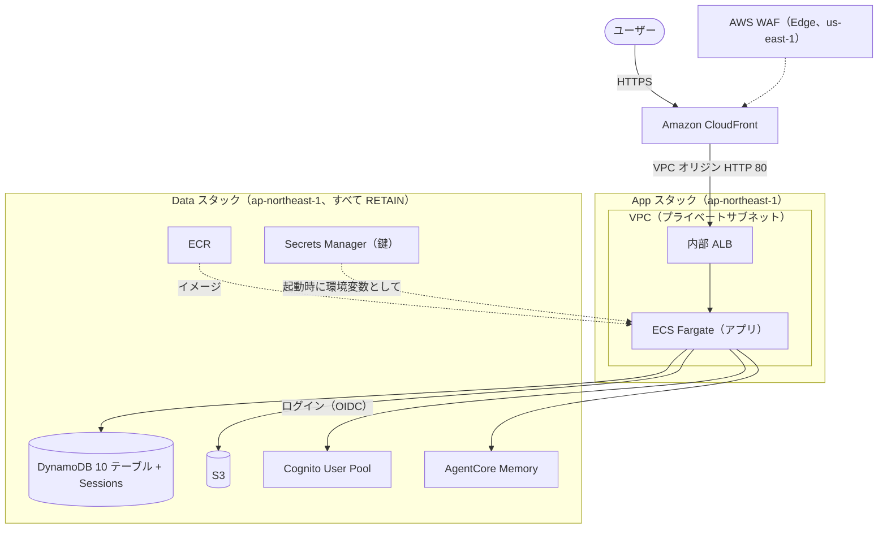
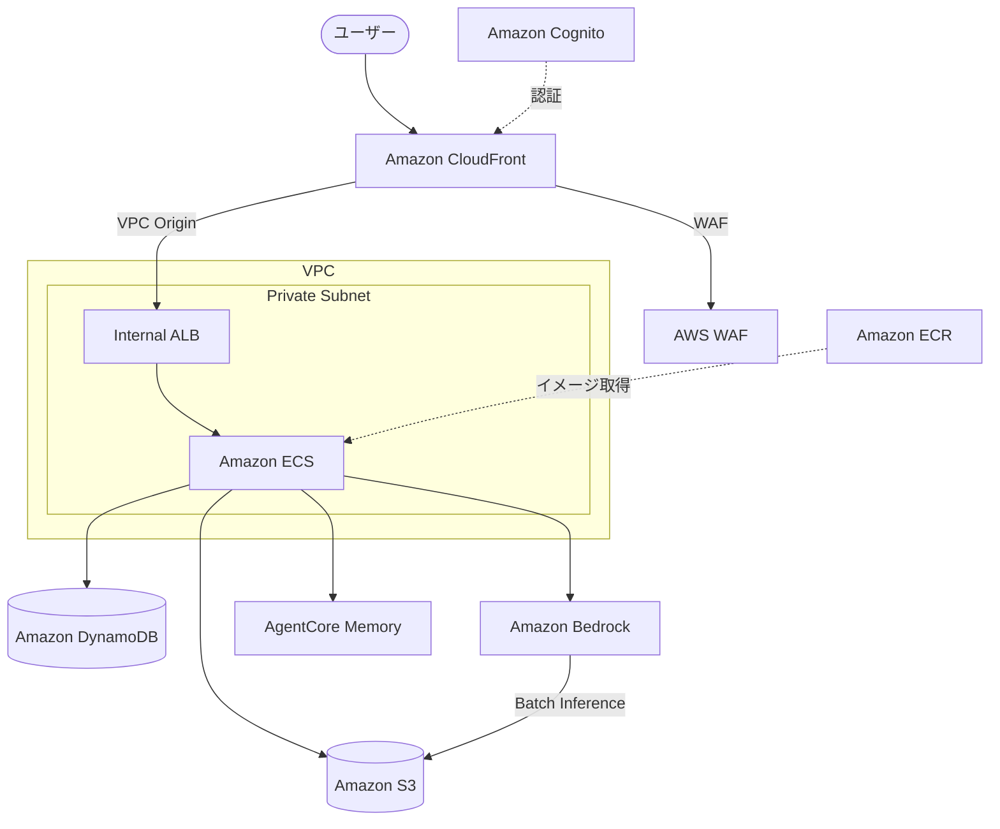

# AI ペルソナシステムの AWS CDK デプロイについて

AI ペルソナシステムを AWS にデプロイするための CDK コードです。v1.0.0 では、ログインをアプリ自身が行い（Lambda@Edge をやめた）、アプリを ECS Fargate と内部 ALB で動かし、CDK を Data・App・Edge の 3 スタックに分けました。

v1.0.0 より前の構成（ECS Express Mode と Lambda@Edge の認証）を使い続ける場合は、後半の「[v0 を使い続ける場合](#v0-を使い続ける場合v100-より前の構成)」を参照してください。

## v1.0.0 の構成



テキストでの説明: 利用者は CloudFront（WAF はオプション）から内部 ALB を経てアプリへ届きます。アプリは Cognito Managed Login でログインさせ、ログインセッションを DynamoDB の Sessions テーブルに置きます。状態を持つもの（テーブル、S3、ECR、User Pool、AgentCore Memory、鍵）は Data スタックにあり、すべて RETAIN です。App スタックは壊して作り直せます。

| スタック（Stage `AIPersonaDev`） | リージョン | 中身 | 依存 |
|---|---|---|---|
| `AIPersonaDev-Data` | ap-northeast-1 | DynamoDB（既存と同じ形の 10 テーブル + Sessions、U4 の ResourceShares、U5 の PersonaCandidates・PersonaBindings）、S3、ECR、Cognito User Pool、AgentCore Memory、KMS キー、トークンの暗号化鍵・ログイン途中の Cookie の署名鍵 | なし |
| `AIPersonaDev-Edge` | us-east-1 | CloudFront 用の WAF WebACL（`enableWaf: true` のとき） | なし |
| `AIPersonaDev-App` | ap-northeast-1 | VPC、内部 ALB、ECS Fargate、CloudFront、Cognito のアプリクライアント、ロググループとメトリクスフィルタ | Data、Edge |

App スタックのタスクロールには、部署の一覧を読むための `cognito-idp:ListGroups`（Data スタックの User Pool だけ）を付けています。メトリクスフィルタには、認可の拒否を `reason`（`denied`・`hidden`・`not_found`・`role_required`）ごとに数える `AIPersona/Auth` の `AuthzDenied` があります（アラームはなし）。

v0 のスタック（`AIPersona-dev`、`AIPersonaEcr-dev`、`AIPersonaCognito-dev` など）とは名前が重ならないため、同じアカウントに並べて動かせます（切り戻しの備え）。v0 のスタックの削除は、利用者が判断して手で行ってください。

### v1.0.0 のデプロイ（CloudShell）

前提: CloudShell（ap-northeast-1）で、作業ツリーに未コミットの変更がないこと（イメージのタグに Git のコミットの短いハッシュを使うため）。

```bash
git clone https://github.com/aws-samples/sample-ai-persona.git
cd sample-ai-persona
./deploy.sh
```

`deploy.sh` は次の順に動きます。人が ID を書き写す手順はありません。

1. CDK の依存のインストールと bootstrap（ap-northeast-1 と us-east-1）
2. ① `AIPersonaDev/Data` と `AIPersonaDev/Edge` をデプロイ（ECR を含む Data を先に作る）
3. ② コンテナイメージをビルドし、Data の ECR へ送る（タグは `git rev-parse --short HEAD`。同じタグがあれば送らない。ECR のタグは不変）
4. ③ `AIPersonaDev/App` を `-c imageTag=<タグ>` でデプロイ
5. アプリの URL と、最初の admin を作るコマンドを表示

| オプション | 使いどころ |
|---|---|
| `--restart-app` | Secrets Manager の秘密の値を書き換えたあと。ECS のタスクを入れ替えて完了を待つ（①〜③はしない） |
| `--image-tag <タグ>` | 前の版に戻すとき。ビルドせず、ECR にあるそのタグで③を行う |
| `--region <リージョン>` | Data・App のリージョン（既定 ap-northeast-1。Edge は常に us-east-1） |

デプロイの前に、ローカルの検査（`uv run pytest -q`、`uv run ruff check .`、`uv run mypy src/ web/`、`cd cdk && npx tsc --noEmit && npm test && npx cdk synth --no-staging`）を通し、差分を確かめてください。ステートフルなリソース（DynamoDB、S3、Cognito User Pool）の置き換え（replace）があれば止めます。

```bash
cd cdk && npx cdk diff 'AIPersonaDev/*' -c imageTag=$(git rev-parse --short HEAD)
```

#### 最初の admin を作る

`deploy.sh` の最後に表示されるコマンドで、利用者を作って `role:admin` のグループに入れます。仮のパスワードがメールで届き、初回ログインで新しいパスワードを設定します。部署は `group:<名前>` のグループで表します（U1 では画面上部にグループ名をそのまま出します）。

`role:admin` にも `role:member` にも入っていない利用者は、ログインすると「利用権限がまだありません」の画面に送られ、ログアウトしかできません（API は 403 の `role_required`）。グループに入れたあとは、ログアウトしてログインし直すと使えるようになります。

#### 閉域構成の利用者（後続リリース）

閉域構成（`deploymentMode=closed`）は後続リリースで提供します（v1.0.0 では synth でエラー）。閉域構成ではアプリ自身のログイン画面（`AUTH_MODE=admin_api`）を使うため、利用者の作成とパスワードの再設定は次のとおりに行います。

- **作成は一時パスワード付きで行う。** 利用者は初回ログインで「パスワードの設定」画面に移り、新しいパスワードを設定するとそのままログインします。グループ（`role:*`・`group:*`）の付け方は上と同じです。

  ```bash
  aws cognito-idp admin-create-user --user-pool-id <User Pool ID> \
    --username <メールアドレス> \
    --user-attributes Name=email,Value=<メールアドレス> Name=email_verified,Value=true \
    --temporary-password '<一時パスワード>'
  ```

- **パスワードの再設定は、一時パスワードの設定で行う。** コンソールの「パスワードをリセット」は使いません（再設定が必要な状態の利用者は、ログイン画面で「メールアドレスまたはパスワードが違います」になり、先へ進めないため）。一時パスワードを設定すると、次のログインで再び「パスワードの設定」画面に移ります。

  ```bash
  aws cognito-idp admin-set-user-password --user-pool-id <User Pool ID> \
    --username <メールアドレス> --password '<一時パスワード>' --no-permanent
  ```

一時パスワードは User Pool のパスワードの条件を満たす必要があります。利用者には別の経路（メールなど）で伝え、コマンドの履歴に残さないよう注意してください。

#### 閉域構成のリリースで行うこと（v1.0.0 から送った項目）

v1.0.0 ではアプリ側のログイン（`AUTH_MODE=admin_api`）だけを作り、AWS では動かしていません（公開構成には切り替えを作らない）。閉域構成のスタックを作るリリースで、次を作り、確かめます。

| 項目 | 内容 |
|---|---|
| App の環境変数 | closed の分岐で `AUTH_MODE=admin_api` と、パスワードの条件の 5 つ（`PASSWORD_MIN_LENGTH`・`PASSWORD_REQUIRE_UPPERCASE`・`PASSWORD_REQUIRE_LOWERCASE`・`PASSWORD_REQUIRE_DIGITS`・`PASSWORD_REQUIRE_SYMBOLS`）。値は User Pool のパスワードポリシーと同じ定数から作る |
| App クライアント | closed の User Pool のクライアントに `ADMIN_USER_PASSWORD_AUTH`（と `REFRESH_TOKEN_AUTH`）を許す |
| タスクロール | `cognito-idp:AdminInitiateAuth`・`cognito-idp:AdminRespondToAuthChallenge`（closed の User Pool の ARN だけ） |
| 内部 ALB の TLS | 閉域構成ではパスワードがアプリを通るため、ALB までを TLS にする |
| Cognito への経路 | `cognito-idp` の VPC エンドポイント |
| AWS での確かめ | Cognito の一時停止（パスワードを続けて間違えた利用者）が画面の「試行回数が上限に達しました」になること、ログインの応答時間の 95 パーセンタイル（20 回以上）、App クライアントの設定の変更が置き換えにならないこと（`npx cdk diff`） |

#### 設定（`cdk/parameters.ts`）

v1.0.0 では `deploy.sh` のオプションで設定を変えず、`cdk/parameters.ts` を編集してコミットしてから `./deploy.sh` を実行します。

| 項目 | 既定 | 説明 |
|---|---|---|
| `appDesiredCount` | 1 | タスクの台数（1〜10。範囲外は synth でエラー）。`-c appDesiredCount=2` でも変えられる |
| `deploymentMode` | `public` | `closed`（閉域構成）は後続リリースで提供。v1.0.0 では synth でエラー |
| `enableWaf` / `allowedIpAddresses` | `false` / なし | CloudFront 用 WAF と IP 制限 |
| `enableAdditionalPersonaModels` | `false` | 追加ペルソナベースモデル（Bedrock Mantle 経由） |
| `enableDatasetAnalysis` | `true` | データセット構造化分析ツール |
| `dataAgentRuntimeArn` / `dataAgentRegion` | なし | データ分析エージェント連携 |
| `enableMcpGateway` | `false` | MCP Gateway は後続リリースで提供。v1.0.0 では `true` にすると synth でエラー |

Cognito の ID、AgentCore Memory の ID・Strategy ID を手で書き写す項目はなくなりました（スタック間の参照と、アプリの起動時の `GetMemory` で受け渡す）。

#### 更新時の再デプロイ

最新のコードを取り込んで（コミットされた状態で）`./deploy.sh` を実行します。コードが変わっていなければイメージは送り直しません。

#### 前の版に戻す

```bash
./deploy.sh --image-tag <前のタグ>
```

U6（議論・インタビュー）からは、戻すのはアプリのイメージだけです。CDK は今のコミットのまま、上のコマンドで前のイメージのタグを渡します（ビルドはせず、Data と App の CDK は今のまま、App のイメージだけが前の版になる）。新しいタスクが起動に失敗したときは、ECS のデプロイのサーキットブレーカーが前のタスク定義に自動で戻すため、手で戻す必要はありません。

- 前のアプリは U6 の新しい 4 テーブル（`DiscussionMessages`・`DiscussionReports`・`InterviewSessions`・`InterviewMessages`）を使いません。U6 のあとに保存した議論は、前のアプリからは発言とレポートのない議論に見えます。もう一度 U6 以降のイメージでデプロイすれば、同じテーブルを読むため元どおり見えます
- **CDK を U6 より前のコミットに戻して `./deploy.sh` を流さないでください。** `deploy.sh` は Data スタックを先に更新するため、今の App スタックが使っている新しいテーブルの出力を消せずに止まります（U5 で起きた失敗と同じ）。仮に通っても、`Discussions` の `OwnerIndex` は削除され、新しいテーブルはスタックから外れ（RETAIN で実体は残るが、物理名が自動生成のため入れ直すと別の空のテーブルになる）、保存した発言・レポートが見えなくなります
- U7（アンケート・組織資産）でも同じく、戻すのは **App スタックのイメージだけ** です（`./deploy.sh --image-tag <前のタグ>`）。**Data スタックは戻しません。** GSI には RETAIN が効かないため、`SurveyTemplates`・`Surveys` の `OwnerIndex` は Data を戻すと削除されます。`CustomPersonaData` テーブルはスタックから外れ（RETAIN で実体は残る）、物理名が自動生成のため入れ直すと別の空のテーブルになって、登録したカスタムデータが見えなくなります
- 前のアプリは `CustomPersonaData` を使わず、S3 のファイル名でカスタムデータを並べます。U7 のあとに登録したカスタムデータは名前ではなく ID（`persona-dataset/custom/{ID}.parquet`）で出て、利用範囲も効きません。テンプレート・結果の見え方も U6 のとき（所有者・共有で絞らない）に戻ります。前の版に戻している間は、利用範囲を絞りたいデータの扱いに気をつけてください。もう一度 U7 以降のイメージでデプロイすれば元どおりになります

U5 より前の版のことは次の段落のとおりです。戻し方は「前に直す」（直したコミットで `./deploy.sh` をやり直す）が基本です。`deploy.sh` は App だけでなく Data も入れ直すため、前のコミットに戻すと Data スタックの形も前に戻ります。U5 の後で U5 より前のコミットまで戻したときは次のようになります。

- `PersonaCandidates`・`PersonaBindings` はスタックの定義から外れて切り離されます（RETAIN のため実体とデータは残る）。もう一度 U5 を入れると、新しい 2 テーブルは別の物理名で空のまま作られ、切り離されたテーブルのデータ（紐付け、候補）は自動では戻りません。dev では紐付けを画面で作り直します（v1.0.0 は移行を持たない）
- 古い紐付けの 2 テーブル（`PersonaDatasetBindings`・`PersonaKBBindings`）は U5 の間も残してあり、前の版のアプリはそれを読みます。U5 の後に作った紐付けは前の版からは見えません
- アップロード用バケットのライフサイクル（下）がなくなり、`UploadedFiles` の TTL も外れます（消えるはずのものが残るだけで、消えるものは増えません）
- U5 の後は、イメージだけを前のタグに戻す（`--image-tag`）方法は使えません。新しい App スタックの権限には古い紐付けのテーブルがなく、前のアプリが紐付けを読めないためです
- 切り離されたテーブルを消すかどうかは、利用者が判断して手で行います（テーブルとバケットは消さない、RETAIN）

前の版から進め直したとき（共有の書き込みが前の版と今の版で食い違ったおそれがあるとき）は、下の「共有の索引（ResourceShares）の作り直し」の差分を流して、ずれがないことを確かめます。

#### インフラの変更を確かめる

CDK を変えたときは、デプロイの前に差分を見ます（`deploy.sh` と同じ形）。

```bash
cd cdk && npx cdk diff 'AIPersonaDev/*' -c imageTag=<タグ>
```

テーブル・バケット・User Pool が置き換わる差分（同じ論理 ID の `[-]` と `[+]`）があれば止めます。v1.0.0 の U4 では `ResourceShares` テーブルの追加と、`Personas` テーブルへの GSI `OwnerIndex` の追加（テーブルは置き換わらない）が出ます。

U5 では次の差分が出ます。どれもテーブル・バケットの置き換えではありません。

- Data: `PersonaCandidates`（PK `candidate_id`、TTL `expires_at`、PITR なし）と `PersonaBindings`（PK `persona_id`・SK `target_key`、GSI `TargetIndex`、PITR、削除保護）の追加。`UploadedFiles` への TTL `expires_at` の追加。アップロード用バケットへのライフサイクルの追加（下の表）
- App: 新しい 2 テーブルの権限（Scan なし）と環境変数 `PERSONA_CANDIDATES_TABLE_NAME`・`PERSONA_BINDINGS_TABLE_NAME` の追加。古い紐付けの 2 テーブルの権限と環境変数の削除（テーブルは残る。外すのは U9）。S3 の権限を `grantReadWrite` から明示的な文に置き換え（古いバージョンの操作は付けない。タグの操作は `uploads/*` と `candidates/*` だけ）

U6 では次の差分が出ます。どれもテーブルの置き換えではありません。

- Data: `DiscussionMessages`（PK `discussion_id`・SK `seq`（数値）、PITR、削除保護）、`DiscussionReports`（PK `discussion_id`・SK `report_id`、PITR、削除保護）、`InterviewSessions`（PK `id`、TTL `expires_at`、PITR なし）、`InterviewMessages`（PK `session_id`・SK `seq`（数値）、TTL `expires_at`、PITR なし）の追加。`Discussions` への GSI `OwnerIndex`（PK `owner_sub`・SK `created_at`、キーだけの射影）の追加。どれも RETAIN
- App: 新しい 4 テーブルの権限（Scan を除く 8 つの操作を 1 つの文で）と環境変数 `DISCUSSION_MESSAGES_TABLE_NAME`・`DISCUSSION_REPORTS_TABLE_NAME`・`INTERVIEW_SESSIONS_TABLE_NAME`・`INTERVIEW_MESSAGES_TABLE_NAME` の追加

U7 では次の差分が出ます。どれもテーブルの置き換えではありません。

- Data: `CustomPersonaData`（PK `id`、GSI なし、PITR、削除保護、AWS 管理キー、RETAIN。名前の押さえの項目 `id="name#{名前}"` も同じテーブル）の追加。`SurveyTemplates`・`Surveys` への GSI `OwnerIndex`（PK `owner_sub`・SK `created_at`、キーだけの射影）の追加（論理 ID は変わらない）
- App: `CustomPersonaData` の権限（`GetItem`・`BatchGetItem`・`PutItem`・`UpdateItem`・`DeleteItem`・`ConditionCheckItem`・`Scan` を 1 つの文で。`Query` とインデックスはなし）と環境変数 `CUSTOM_PERSONA_DATA_TABLE_NAME` の追加。タスクロールのポリシーの JSON は約 6,800 文字（9,000 文字未満を `app-stack.test.ts` で確かめている）

#### 議論の削除で残ったものの後始末（U6）

議論を消すと、本体と共有を先に消し、そのあと発言・レポート・資料を 3 回までやり直して消します。それでも残ったもの（本体のない発言・レポート、親の議論がないファイル）は、admin の手元の資格情報で次のスクリプトを流して見つけます（アプリのタスクロールには新しいテーブルの Scan の権限がありません）。

```bash
# 既定は件数を出すだけで、何も消さない
uv run python scripts/cleanup_discussion_orphans.py --region ap-northeast-1
# 件数を確かめたら、--apply を付けて消す（S3 のファイルも消す）
uv run python scripts/cleanup_discussion_orphans.py --region ap-northeast-1 --apply
```

テーブル名は `DISCUSSIONS_TABLE_NAME`・`DISCUSSION_MESSAGES_TABLE_NAME`・`DISCUSSION_REPORTS_TABLE_NAME`・`UPLOADED_FILES_TABLE_NAME`（`src/config.py`）で渡します。今ある議論から届くものには触れません。保存の途中の議論（資料と発言は書いたが本体はまだ）を消さないよう、書かれてから 1 時間たっていない議論は対象にせず（件数だけ出す）、`--apply` は消す直前に本体がないことを確かめ直します。

#### アンケートとカスタムデータの削除で残ったものの後始末（U7）

アンケートを消すと、本体と共有を先に消し、そのあと結果の CSV を 3 回までやり直して消します。カスタムペルソナデータを消すと、登録情報（と名前の押さえ）を先に消し、そのあと Parquet を 3 回までやり直して消します。それでも残ったもの（本体のない `survey-results/{ID}/` と、登録情報のない `persona-dataset/custom/{ID}.parquet`）は、admin の手元の資格情報で次のスクリプトを流して見つけます（アプリのタスクロールには、これらの一覧の権限がありません）。

```bash
# 既定は件数を出すだけで、何も消さない
uv run python scripts/cleanup_survey_orphans.py --region ap-northeast-1
# 件数を確かめたら、--apply を付けて消す
uv run python scripts/cleanup_survey_orphans.py --region ap-northeast-1 --apply
```

バケットとテーブルの名前は `S3_BUCKET_NAME`・`DYNAMODB_TABLE_PREFIX`・`CUSTOM_PERSONA_DATA_TABLE_NAME`（`src/config.py`）で渡します。ID（UUID）の名前のものだけを対象にし、v1.0.0 より前の名前のファイル（`persona-dataset/custom/{データセット名}.parquet` など）と一時ファイルには触れません。保存の途中（結果の CSV や Parquet は書いたが本体・登録情報はまだ）のものを消さないよう、書かれてから 1 時間たっていないものは対象にせず（件数だけ出す）、`--apply` は消す直前に本体・登録情報がないことを確かめ直します。

#### アップロード用バケットのライフサイクル（U5）

| ルール | 対象 | 動作 |
|---|---|---|
| `ExpireCandidateCsv` | `candidates/`（生成候補の行動データの一時 CSV） | 作成から 1 日で失効 |
| `ExpireUnattachedUploads` | タグ `pending=true`（議論・テンプレートに使われていないアップロード） | 作成から 1 日で失効 |
| `ExpireNoncurrentVersions` | バケット全体 | 古いバージョンは 7 日で削除、期限切れの削除マーカーを掃除、未完了のマルチパートは 7 日で中止 |

バケットはバージョニングを有効にしているため、アプリが消したオブジェクト（ペルソナの削除で消したアバター・専用データセットなど）は古いバージョンとして 7 日間残り、そのあと消えます。アプリのタスクロールには古いバージョンを読む権限がないため、その 7 日の間もアプリからは読めません。誤って消したものを戻すときは、admin の資格情報で 7 日以内に古いバージョンを取り出します。

#### 共有の索引（ResourceShares）の作り直し

`ResourceShares` は部署ごとの共有の索引で、正は各テーブルの本体の `shared_group_ids` です。索引だけがずれたとき（または本体を戻したとき）は、PITR で戻さずに本体から作り直します。admin の手元の資格情報で流します（アプリのタスクロールには `ResourceShares` の Scan の権限がありません）。

```bash
# 既定は差分（足りない項目・余分な項目・created_at と owner_sub の食い違い）を出すだけ
uv run python scripts/rebuild_resource_shares.py --region ap-northeast-1 --shares-table <ResourceShares の物理名>
# 差分を確かめたら、--apply を付けて直す
uv run python scripts/rebuild_resource_shares.py --region ap-northeast-1 --shares-table <ResourceShares の物理名> --apply
```

本体のテーブル名は `PERSONAS_TABLE_NAME` などの環境変数（`src/config.py`）で渡します。`owner_sub` のない本体（v1.0.0 より前のデータ）は数えて飛ばします。

#### 本体のテーブルを PITR で戻す

1. 戻したい時刻を決め、本体のテーブル（例: `Personas`）を PITR で**新しいテーブル**に復元する（元のテーブルは消さない）

   ```bash
   aws dynamodb restore-table-to-point-in-time \
     --source-table-name <Personas の物理名> \
     --target-table-name <Personas の物理名>-restore-<日時> \
     --restore-date-time <ISO 8601 の時刻>
   ```

2. 復元したテーブルの項目を元のテーブルへ書き戻す（`aws dynamodb scan` で読み、`aws dynamodb batch-write-item` で書く。U4 では書き戻しのスクリプトを用意していない）
3. 共有の索引の作り直しを差分だけで流し、出た差分が戻した時刻のとおりかを確かめる
4. `--apply` を付けて流し、索引を本体に合わせる
5. 確かめ終わったら、復元に使った新しいテーブルを手で消す（元のテーブルではないことを確かめてから）

#### トークンの暗号化鍵の入れ替え

Secrets Manager の `TokenEncryptionKeys`（`{"current": "v1", "k_v1": "..."}`）を手で書き換え、そのたびに `./deploy.sh --restart-app` でタスクを入れ替えます（秘密の値を変えても `cdk deploy` には差分が出ないため）。

1. 新しい版（例: `"k_v2": "<64 文字の乱数>"`）を足し、`--restart-app`（暗号化はまだ `current` の古い版）
2. すべてのタスクが入れ替わったら `current` を新しい版にして、`--restart-app`
3. 7 日後（セッションの最長）に古い版を外して、`--restart-app`

### v1.0.0 の手元の開発

手元では `AUTH_MODE=local` で起動します（Cognito・DynamoDB の Sessions テーブル・Secrets Manager を使わず、設定した開発用の利用者でログインする）。詳しくは [ローカル開発ガイド](../docs/local_development.md) を参照してください。`AUTH_MODE=local` は ECS の中では起動しません。

---

# v0 を使い続ける場合（v1.0.0 より前の構成）

以下は v1.0.0 より前の構成（ECS Express Mode、CloudFront Lambda@Edge + cognito-at-edge の認証、6 スタック）の手順です。v1.0.0 のコードには v0 のスタックの定義（`AIPersona-dev` など）がないため、この手順を実行するときは v1.0.0 より前のリリースのタグを取り出してください。デプロイ済みの v0 のスタックは、v1.0.0 をデプロイしてもそのまま残ります。

## アーキテクチャ



### セキュリティ構成

- **CloudFront + WAF（オプション）**: ユーザーのアクセスエンドポイント。AWS WAFによるレートリミット + AWSマネージドルールでの保護
- **Cognito認証**: CloudFront Lambda@Edge + cognito-at-edgeライブラリで自動認証
- **VPC Origin**: CloudFrontからInternal ALBへのプライベート接続
- **Internal ALB**: ECS Express Modeが自動管理（ACM証明書 + HTTPSリスナー自動作成）
- **Private Subnet**: ECSタスクはプライベートサブネット配置


## Stack構成

| Stack ID | 説明 | 依存関係 |
|----------|------|----------|
| AIPersonaMemory-{env} | AgentCore Memory（長期記憶） | なし |
| AIPersonaEcr-{env} | ECRリポジトリ | なし |
| AIPersona-{env} | VPC + DynamoDB + ECS Express + CloudFront + WAF + Lambda@Edge認証 | AIPersonaEcr |
| AIPersonaCognito-{env} | Cognito User Pool | なし（先行デプロイ） |

## 開発環境
- Docker（Docker buildにはx86環境推奨）
- Node.js（CDKの実行に必要）
- Python 3.13以上
- AWS CLI
- uvパッケージマネージャ

AWSのCloudshellを使ってDockerイメージのビルドやプッシュ、CDKでのデプロイが行えます。

## デプロイ順序

```
AIPersonaEcr → (Docker Push) → AIPersonaCognito → AIPersonaMemory (手動でIDを取得) → AIPersonaWaf (オプション) → AIPersona
```

**重要**: 
1. ECRとDockerイメージのプッシュ後、CognitoStackをデプロイし、出力されたUser Pool ID/Client ID/Domainを`parameters.ts`に設定
2. AgentCoreMemoryStackをデプロイし、出力されたMemory IDとStrategy IDを`parameters.ts`に設定
3. メインスタックをデプロイ（Lambda@Edge認証 + CloudFront + ECS）
4. デプロイ後、CognitoのcallbackUrlをCloudFrontドメインに更新

## パラメータ

| パラメータ名 | 説明 |
|-------------|------|
| envName | 環境名（dev/prod） |
| dynamoDbTablePrefix | DynamoDBテーブルのプレフィックス |
| cognitoDomainPrefix | Cognitoドメインのプレフィックス |
| cognitoUserPoolId | Cognito User Pool ID（CognitoStackから取得） |
| cognitoUserPoolAppId | Cognito Client ID（CognitoStackから取得） |
| cognitoUserPoolDomain | Cognito Domain（CognitoStackから取得） |
| containerCpu | タスクのCPU（"256", "512", "1024", "2048", "4096"） |
| containerMemory | タスクのメモリ（"512", "1024", "2048", etc.） |
| enableWaf | CloudFront WAFの有効化（dev: false / prod: true） |
| allowedIpAddresses | WAF IPアドレス制限（CIDR形式の配列、enableWaf: true時のみ有効） |
| selfSignUpEnabled | Cognitoセルフサインアップの有効/無効（デフォルト: false） |
| agentCoreMemoryId | AgentCore MemoryのID（AgentCoreMemoryStackから取得） |
| summaryMemoryStrategyId | Summary戦略のID（AWS CLIで取得） |
| semanticMemoryStrategyId | Semantic戦略のID（AWS CLIで取得、知識・事実機能用） |
| agentCoreMemoryEventExpiryDays | イベント保持期間（日数、デフォルト: dev=30 / prod=90） |
| bedrockModelId | Bedrock AIモデルID |
| agentModelId | Agent用モデルID |
| enableAdditionalPersonaModels | 追加ペルソナベースモデル（GPT-5.6 Terra/Luna、Gemma 4 31B。Bedrock Mantle経由）の選択を有効化（デフォルト: false） |
| batchInferenceModelId | マスアンケート用バッチ推論モデルID |
| surveyS3Prefix | アンケート結果CSV保存先S3プレフィックス |
| batchInferenceS3Prefix | バッチ推論入出力S3プレフィックス |
| dataAgentRuntimeArn | データ分析エージェントのRuntime ARN（任意） |
| dataAgentRegion | データ分析エージェントのリージョン（任意、省略時はメインリージョン） |

## CloudShellとスクリプトによる自動デプロイ

AWS CDKや Docker の環境準備が不要で、CloudShellとスクリプトを利用して、自動でデプロイを行う手順です。

### 前提条件

- AWSマネジメントコンソールにログイン済み
- 適切なIAM権限を持つアカウント（CDKでアプリをデプロイするための権限が必要）

### 手順

#### 1. CloudShellを開く

1. AWSマネジメントコンソール右上の CloudShell アイコンをクリック
2. デプロイ先のリージョン（例: `us-east-1`, `us-west-2`, `ap-northeast-1`）が選択されていることを確認

#### 2. デプロイ実行

```bash
git clone https://github.com/aws-samples/sample-ai-persona.git
cd sample-ai-persona
chmod +x deploy.sh
./deploy.sh --region <AWS_REGION>
```

> デフォルトのデプロイ先は `us-east-1` です。他のリージョンにデプロイする場合は `--region` を指定してください（例: `--region us-west-2`, `--region ap-northeast-1`）。

全自動で ECR → Docker ビルド → Cognito → AgentCore Memory → ECS + CloudFront + Lambda@Edge認証 → callbackUrl更新 がデプロイされます。

> セルフサインアップはデフォルト無効（管理者がユーザーを作成）。有効にする場合は `--self-signup` オプションを指定してください。

> **⚠️ 注意（初回デプロイ時のCloudShellセッションタイムアウト）**: 初回デプロイはデプロイするリソースが多く時間がかかります。CloudShellのセッションタイムアウトを超えると、最後のステップであるCloudFront URLを使ったcallbackUrlの更新が反映されない可能性があります。デプロイ中はキー操作などを行いセッションが切れないようにするか、CloudFrontの処理が完了する前にセッションがアイドル状態で切れてしまった場合は、[CognitoのcallbackUrl更新](#10-cognitoのcallbackurl更新)を手動で実行してください。

#### オプション

```bash
# 環境名・リージョンを指定（デフォルト環境：dev、デフォルトリージョン：us-east-1）
./destroy.sh --env prod --region us-west-2

# 長期記憶機能をスキップ（長期記憶機能をスキップしたい場合）
./deploy.sh --skip-memory

# Cognito認証をスキップ（初回以降は必須）
./deploy.sh --skip-cognito

# 両方スキップ（初回デプロイ以降の更新）
./deploy.sh --skip-memory --skip-cognito

# セルフサインアップを有効化
./deploy.sh --self-signup

# WAF IP制限（カンマ区切りCIDR、WAFは自動有効化）
./deploy.sh --allowed-ips "203.0.113.0/24,198.51.100.1/32"

# 追加ペルソナベースモデル（GPT-5.6 Terra/Luna、Gemma 4 31B。Bedrock Mantle経由）を有効化
./deploy.sh --enable-additional-persona-models

# データ分析エージェント連携を有効化（AgentCore Runtime ARNを指定）
./deploy.sh --data-agent-arn "arn:aws:bedrock-agentcore:us-east-1:123456789012:runtime/xxx"

# データ分析エージェントのリージョンが異なる場合
./deploy.sh --data-agent-arn "arn:aws:..." --data-agent-region ap-northeast-1

# 外部公開用の MCP Server 有効化 
./deploy.sh --enable-mcp
```

#### 更新時の再デプロイ

```bash
cd sample-ai-persona
git pull
chmod +x deploy.sh
./deploy.sh --skip-memory --skip-cognito --region <AWS_REGION>
```
- `--skip-memory` `--skip-cognito` を指定しても、既存スタックから設定を自動取得するため、Lambda@Edge認証やMemory設定は維持されます
- データ分析エージェント連携も同様に、既存スタックから自動引き継ぎされます（明示的に解除する場合は `--data-agent-arn ""` を指定）
- アプリケーションのみの変更の場合、新しいDockerイメージがECRにPUSHされます。
- タイムスタンプベースのイメージタグにより、`cdk deploy`時にECSタスク定義が自動更新され、ローリングデプロイが実行されます。
- CloudFrontの設定変更がある場合、反映に数分かかることがあります。

### 環境削除

デプロイした環境を完全に削除するには、`destroy.sh`を使用します。

```bash
chmod +x destroy.sh
./destroy.sh --region <AWS_REGION>
```

スタックの依存関係に基づき、正しい順序（MCP → Cognito → Main → WAF → Memory → ECR）で自動削除されます。
MCP Gateway（`--enable-mcp` でデプロイした場合）はメインスタックの export を参照しているため、メインスタックより先に削除されます。
dev環境ではS3バケットの中身は `autoDeleteObjects` により自動削除されます。

デプロイ先リージョンが us-east-1 以外の場合、Lambda@Edge の関数は us-east-1 に自動生成されるサポートスタック（`edge-lambda-stack-*`）に配置されます。`destroy.sh` はこれを検出し、メインスタック削除後に us-east-1 で削除します。ただし CloudFront のレプリカ削除には数時間かかるため、初回は削除に失敗することがあります。その場合は時間を置いて再度 `./destroy.sh` を実行してください。

#### オプション

```bash
# 確認プロンプトをスキップ
./destroy.sh --force

# 環境名・リージョンを指定
./destroy.sh --env prod --region us-west-2
```


---

## 手動デプロイ手順

以下は、スクリプトを使わずに手動でCDKを利用し、デプロイする場合の手順です。

### 1. 依存関係のインストール

```bash
cd cdk
npm install
```

### 2. パラメータの初期設定

`parameters.ts`を編集して環境に合わせた基本設定を行います。
この時点では、AgentCore MemoryのIDは空文字列のままで構いません。

**重要: cognitoDomainPrefixの設定**

`cognitoDomainPrefix`はAWS全体でグローバルに一意である必要があります。デフォルト値のままだと他のユーザーと重複してデプロイに失敗する可能性があるため、末尾にランダムな文字列などを付与してください。

```typescript
// 例: ランダム文字列を付与
cognitoDomainPrefix: 'ai-persona-dev-abc123xyz',
```

### 3. CDK Bootstrap（初回のみ）

```bash
npx cdk bootstrap aws://<ACCOUNT_ID>/<AWS_REGION>
```

**重要: `<AWS_REGION>` が us-east-1 以外の場合**

Lambda@Edge（`cloudfront.experimental.EdgeFunction`）と WAF WebACL は us-east-1 に作成されます。特に Lambda@Edge のサポートスタックは Lambda コードをアセットとして含むため、デプロイ先リージョンが us-east-1 以外の場合は us-east-1 も bootstrap しないとメインスタックのデプロイが失敗します。

```bash
npx cdk bootstrap aws://<ACCOUNT_ID>/us-east-1
```

### 4. ECR Stackのデプロイ

```bash
npx cdk deploy AIPersonaEcr-dev
```

### 5. Dockerイメージのビルド・プッシュ
作成したECRレポジトリの「プッシュコマンドを表示」で表示されるコマンドを実行します。（下記は例です。）

```bash
cd ..

# ECRログイン
aws ecr get-login-password --region <AWS_REGION> | docker login --username AWS --password-stdin <ACCOUNT_ID>.dkr.ecr.<AWS_REGION>.amazonaws.com

# ビルド
docker build -t ai-persona .
# ※ Apple Silicon Mac上でビルドする場合は以下のように--platform linux/amd64をつける
docker build --platform linux/amd64 -t ai-persona .

# タグ付け
IMAGE_TAG=$(date +%Y%m%d%H%M%S)
docker tag ai-persona:latest <ECR_REPOSITORY_URI>:${IMAGE_TAG}
docker tag ai-persona:latest <ECR_REPOSITORY_URI>:latest

# プッシュ
docker push <ECR_REPOSITORY_URI>:${IMAGE_TAG}
docker push <ECR_REPOSITORY_URI>:latest
```

### 6. AgentCore Memory Stackのデプロイ（長期記憶を使用する場合）

**長期記憶機能を使用しない場合は、このステップをスキップして手順7に進んでください。**

#### 6-1. Memory Stackのデプロイ

```bash
cd cdk
npx cdk deploy AIPersonaMemory-dev
```

デプロイが完了すると、以下の出力が表示されます：

```
Outputs:
AIPersonaMemory-dev.MemoryId = memory_ai_persona-XXXXXXXXXX
AIPersonaMemory-dev.GetStrategyIdCommand = aws bedrock-agentcore-control get-memory --memory-id memory_ai_persona-XXXXXXXXXX --region <AWS_REGION> --query 'memory.strategies[?type==`SUMMARIZATION`].strategyId' --output text
AIPersonaMemory-dev.GetSemanticStrategyIdCommand = aws bedrock-agentcore-control get-memory --memory-id memory_ai_persona-XXXXXXXXXX --region <AWS_REGION> --query 'memory.strategies[?type==`SEMANTIC`].strategyId' --output text
AIPersonaMemory-dev.NextSteps = IMPORTANT: After deployment, run "aws bedrock-agentcore-control get-memory --memory-id <MEMORY_ID>" to get the Strategy ID, then update parameters.ts
```

#### 6-2. Strategy IDの取得

出力された`GetStrategyIdCommand`と`GetSemanticStrategyIdCommand`を実行して、各Strategy IDを取得します：

**Summary Strategy ID:**
```bash
aws bedrock-agentcore-control get-memory \
  --memory-id memory_ai_persona-XXXXXXXXXX \
  --region <AWS_REGION> \
  --query 'memory.strategies[?type==`SUMMARIZATION`].strategyId' \
  --output text
```

出力例：
```
summary-cGiRRh8umv
```

**Semantic Strategy ID:**
```bash
aws bedrock-agentcore-control get-memory \
  --memory-id memory_ai_persona-XXXXXXXXXX \
  --region <AWS_REGION> \
  --query 'memory.strategies[?type==`SEMANTIC`].strategyId' \
  --output text
```

出力例：
```
semantic-XYZ1234abc
```

#### 6-3. parameters.tsの更新

取得したIDを`parameters.ts`に設定します：

```typescript
export const devParameter: AppParameter = {
  // ...
  agentCoreMemoryId: 'memory_ai_persona-XXXXXXXXXX',  // 6-1で取得したMemory ID
  summaryMemoryStrategyId: 'summary-cGiRRh8umv',      // 6-2で取得したSummary Strategy ID
  semanticMemoryStrategyId: 'semantic-XYZ1234abc',    // 6-2で取得したSemantic Strategy ID
};
```

**長期記憶を使用しない場合**は、空文字列を設定します：

```typescript
export const devParameter: AppParameter = {
  // ...
  agentCoreMemoryId: '',
  summaryMemoryStrategyId: '',
  semanticMemoryStrategyId: '',
};
```

### 7. Cognito Stackのデプロイ（認証を使用する場合）

```bash
npx cdk deploy AIPersonaCognito-dev
```

デプロイ完了後、出力されたIDを`parameters.ts`に設定します：

```typescript
cognitoUserPoolId: 'us-east-1_XXXXXXXXX',       // UserPoolId出力値
cognitoUserPoolAppId: 'xxxxxxxxxxxxxxxxxx',       // UserPoolClientId出力値
cognitoUserPoolDomain: 'xxx.auth.us-east-1.amazoncognito.com',  // UserPoolDomainName出力値
```

### 8. WAF Stackのデプロイ（IP制限を使用する場合）

**WAFの機能（IP制限、レートリミットなど）が不要な場合は、このステップをスキップして手順9に進んでください。**

`parameters.ts`でWAFとIP制限を設定します：

```typescript
enableWaf: true,
allowedIpAddresses: ['203.0.113.0/24', '198.51.100.1/32'], // 許可するIPアドレス
```

WAFスタックはCloudFront用のためus-east-1にデプロイされます：

```bash
npx cdk deploy AIPersonaWaf-dev
```

> **注意**: CommonRuleSet の `SizeRestrictions_BODY`（ボディ8KB制限）はファイルアップロードと両立しないため、`lib/waf-stack.ts` でCountに落としています。

### 9. Main Stackのデプロイ

```bash
# Lambda@Edge依存関係のインストール
cd lambda/auth-at-edge && npm install && cd ../..

npx cdk deploy AIPersona-dev -c "imageTag=${IMAGE_TAG}"
```

### 10. CognitoのcallbackUrl更新

メインスタックのデプロイ後、CloudFrontドメインが確定するので、CognitoのcallbackUrlを更新します：

```bash
CLOUDFRONT_DOMAIN=$(aws cloudformation describe-stacks \
  --stack-name AIPersona-dev --region <AWS_REGION> \
  --query "Stacks[0].Outputs[?OutputKey=='CloudFrontDomainName'].OutputValue" \
  --output text)

# Cognito User Pool ID / Client ID も CognitoStack の出力から取得できる
USER_POOL_ID=$(aws cloudformation describe-stacks \
  --stack-name AIPersonaCognito-dev --region <AWS_REGION> \
  --query "Stacks[0].Outputs[?OutputKey=='UserPoolId'].OutputValue" \
  --output text)
CLIENT_ID=$(aws cloudformation describe-stacks \
  --stack-name AIPersonaCognito-dev --region <AWS_REGION> \
  --query "Stacks[0].Outputs[?OutputKey=='UserPoolClientId'].OutputValue" \
  --output text)

aws cognito-idp update-user-pool-client \
  --user-pool-id "${USER_POOL_ID}" \
  --client-id "${CLIENT_ID}" \
  --region <AWS_REGION> \
  --callback-urls "https://${CLOUDFRONT_DOMAIN}" "https://${CLOUDFRONT_DOMAIN}/" \
  --logout-urls "https://${CLOUDFRONT_DOMAIN}" "https://${CLOUDFRONT_DOMAIN}/" \
  --allowed-o-auth-flows code \
  --allowed-o-auth-scopes openid email profile \
  --allowed-o-auth-flows-user-pool-client \
  --supported-identity-providers COGNITO \
```

### 手動での環境削除

スクリプトを使わずにCDKコマンドで削除する場合

```bash
cd cdk

# 1. MCP Gateway Stack（--enable-mcp でデプロイした場合のみ。メインスタックの
#    export を import しているため、メインスタックより先に削除する）
npx cdk destroy AIPersonaMcp-dev

# 2. Cognito Stack
npx cdk destroy AIPersonaCognito-dev

# 3. Main Stack（S3バケットを先に空にする）
aws s3 rm s3://<BUCKET_NAME> --recursive
npx cdk destroy AIPersona-dev

# 4. WAF Stack（使用している場合、us-east-1にデプロイされている）
npx cdk destroy AIPersonaWaf-dev

# 5. Memory Stack
npx cdk destroy AIPersonaMemory-dev

# 6. ECR Stack（イメージを先に削除）
aws ecr batch-delete-image --repository-name ai-persona-dev \
  --image-ids "$(aws ecr list-images --repository-name ai-persona-dev --query 'imageIds[*]' --output json)"
npx cdk destroy AIPersonaEcr-dev

# 7. Lambda@Edge サポートスタック（デプロイ先が us-east-1 以外の場合のみ）
#    us-east-1 に edge-lambda-stack-<hash> という名前で自動生成されている。
#    レプリカ削除の遅延で数時間は削除に失敗するため、時間を置いてから実行する。
aws cloudformation list-stacks --region us-east-1 \
  --stack-status-filter CREATE_COMPLETE UPDATE_COMPLETE DELETE_FAILED \
  --query "StackSummaries[?starts_with(StackName, 'edge-lambda-stack')].StackName" --output text
aws cloudformation delete-stack --stack-name <EDGE_STACK_NAME> --region us-east-1
```

> **注意**: S3バケットやECRリポジトリに中身が残っていると削除に失敗します。必ず事前にクリーンアップしてください。
>
> **注意**: `--enable-mcp` でデプロイした環境で MCP Gateway スタックを残したままメインスタックを削除しようとすると、export 参照エラーで失敗します。必ず MCP Gateway スタックを先に削除してください。

## 出力値

### AIPersonaMemory-{env}
- `MemoryId`: AgentCore Memory ID（parameters.tsに設定）
- `GetStrategyIdCommand`: Summary Strategy IDを取得するAWS CLIコマンド
- `GetSemanticStrategyIdCommand`: Semantic Strategy IDを取得するAWS CLIコマンド
- `NextSteps`: 次のステップの説明

### AIPersonaEcr-{env}
- `RepositoryUri`: ECRリポジトリURI

### AIPersona-{env}
- `CloudFrontDomainName`: CloudFrontドメイン名（アプリケーションのアクセスURL）
- `InternalServiceEndpoint`: Express Mode内部エンドポイント
- `PersonasTableName`: DynamoDB Personasテーブル名
- `DiscussionsTableName`: DynamoDB Discussionsテーブル名
- `UploadedFilesTableName`: DynamoDB UploadedFilesテーブル名
- `UploadBucketName`: S3アップロードバケット名
- `SurveyTemplatesTableName`: DynamoDB SurveyTemplatesテーブル名
- `SurveysTableName`: DynamoDB Surveysテーブル名
- `BedrockBatchRoleArn`: Bedrock Batch Inference IAMロールARN

### AIPersonaCognito-{env}
- `UserPoolId`: Cognito User Pool ID（parameters.tsに設定）
- `UserPoolClientId`: Cognito Client ID（parameters.tsに設定）
- `UserPoolDomainName`: Cognito Domain（parameters.tsに設定）

## Cognito認証

CloudFront Lambda@Edge + [cognito-at-edge](https://github.com/awslabs/cognito-at-edge) ライブラリで認証を実装しています。

### 認証フロー

```
ユーザー → CloudFront → Lambda@Edge (viewer-request)
  → 未認証: Cognito Hosted UIにリダイレクト → ログイン → CloudFrontにコールバック
  → 認証済み: Cookie検証 → オリジン（Internal ALB）に転送
```

### 初回デプロイ後の設定

1. CognitoStackをデプロイし、出力されたIDを`parameters.ts`に設定
2. メインスタックをデプロイ（Lambda@Edge関数が作成される）
3. CognitoのcallbackUrlをCloudFrontドメインに更新（deploy.shでは自動実行）

### callbackUrlの手動更新（必要な場合）

```bash
# User Pool ID / Client ID / CloudFront ドメインは各スタックの出力から取得できる
USER_POOL_ID=$(aws cloudformation describe-stacks \
  --stack-name AIPersonaCognito-dev --region <REGION> \
  --query "Stacks[0].Outputs[?OutputKey=='UserPoolId'].OutputValue" \
  --output text)
CLIENT_ID=$(aws cloudformation describe-stacks \
  --stack-name AIPersonaCognito-dev --region <REGION> \
  --query "Stacks[0].Outputs[?OutputKey=='UserPoolClientId'].OutputValue" \
  --output text)
CLOUDFRONT_DOMAIN=$(aws cloudformation describe-stacks \
  --stack-name AIPersona-dev --region <REGION> \
  --query "Stacks[0].Outputs[?OutputKey=='CloudFrontDomainName'].OutputValue" \
  --output text)

aws cognito-idp update-user-pool-client \
  --user-pool-id "${USER_POOL_ID}" \
  --client-id "${CLIENT_ID}" \
  --region <REGION> \
  --callback-urls "https://${CLOUDFRONT_DOMAIN}" "https://${CLOUDFRONT_DOMAIN}/" \
  --logout-urls "https://${CLOUDFRONT_DOMAIN}" "https://${CLOUDFRONT_DOMAIN}/" \
  --allowed-o-auth-flows code \
  --allowed-o-auth-scopes openid email profile \
  --allowed-o-auth-flows-user-pool-client \
  --supported-identity-providers COGNITO \
```

## 注意事項

### 初回デプロイの順序

1. `AIPersonaEcr-{env}` をデプロイ
2. Dockerイメージをビルド・プッシュ
3. `AIPersonaCognito-{env}` をデプロイ（認証を使用する場合）
4. Cognito User Pool ID/Client ID/Domainを取得して`parameters.ts`を更新
5. `AIPersonaMemory-{env}` をデプロイ（長期記憶を使用する場合）
6. Memory IDとStrategy IDを取得して`parameters.ts`を更新
7. `AIPersona-{env}` をデプロイ
8. CognitoのcallbackUrlをCloudFrontドメインに更新

### AgentCore Memory Strategy IDの取得

CloudFormationではStrategy IDを直接取得できないため、AWS CLIを使用して取得する必要があります：

**Summary Strategy ID:**
```bash
aws bedrock-agentcore-control get-memory \
  --memory-id <MEMORY_ID> \
  --region <AWS_REGION> \
  --query 'memory.strategies[?type==`SUMMARIZATION`].strategyId' \
  --output text
```

**Semantic Strategy ID:**
```bash
aws bedrock-agentcore-control get-memory \
  --memory-id <MEMORY_ID> \
  --region <AWS_REGION> \
  --query 'memory.strategies[?type==`SEMANTIC`].strategyId' \
  --output text
```

これらのIDは、namespaceパターンで使用されます：
- Summary: `/strategies/{memoryStrategyId}/actors/{actorId}/sessions/{sessionId}`
- Semantic: `/strategies/{memoryStrategyId}/actors/{actorId}`

### ECS Express Modeの特徴

- Internal ALB、セキュリティグループ、オートスケーリング、ACM証明書を自動管理
- Private Subnetに配置（パブリックIPなし）
- CloudFront VPC Origin経由でインターネットに公開
- 専用VPC（`ai-persona-{env}`）上にデプロイ
- ECSクラスター名: `ai-persona-{env}`
- AWS提供ドメイン名を自動付与（`*.ecs.<region>.on.aws`）

### S3バケットの使用

- ファイルアップロードは自動的にS3バケットに保存されます
- バケット名は環境変数`S3_BUCKET_NAME`として自動設定されます
- ECSタスクロールにS3の読み書き権限が付与されています
- バージョニングが有効化されており、誤削除時の復元が可能です

## ECSサービスのアップデート時の注意
- CloudFrontの設定変更がある場合、反映に数分かかることがある
- Lambda@Edgeの更新はCloudFrontのデプロイに含まれる

## トラブルシューティング

### サービスが起動しない

1. ECRにイメージがプッシュされているか確認
2. CloudWatch Logsでコンテナログを確認
3. タスクロールの権限を確認

### アプリケーションにアクセスすると503エラーがかえってくる
- ALBのリスナー設定でターゲットグループを確認する。タスクが登録されていないターゲットグループにトラフィックが振られていないかを確認する

### Cognito認証エラー

1. `redirect_mismatch`: CognitoのcallbackUrlにCloudFrontドメイン（末尾スラッシュあり/なし両方）が登録されているか確認
2. `503 ERROR (Lambda function invalid)`: Lambda@Edgeのcognito-at-edge node_modulesがデプロイされているか確認（`cd cdk/lambda/auth-at-edge && npm install`）
3. Cognito Domainがグローバルで一意か確認
4. parameters.tsのcognitoUserPoolId/AppId/Domainが正しく設定されているか確認

### メインスタックの削除エラー
- Lambda@Edgeのレプリカ削除に時間がかかっている可能性があります。少し時間を置き、再度 ./destroy.sh を実行してください