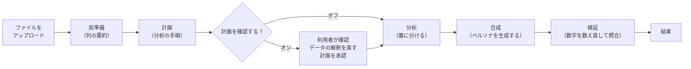

# ペルソナの高度な生成機能活用ガイド

高度な生成（ベータ）を使うユーザー向けに、仕組み・入力データ・指示の書き方をまとめたガイドです。画面の操作手順や設定は[ユーザーガイド](user_guide.md#高度な生成ベータ)を参照してください。

## 目次

- [1. 高度な生成とは](#1-高度な生成とは)
- [2. 仕組み](#2-仕組み)
- [3. 入力データのガイド](#3-入力データのガイド)
- [4. 目的に沿った指示のガイド](#4-目的に沿った指示のガイド)
- [5. 結果を読むときの注意](#5-結果を読むときの注意)
- [6. トラブルシューティング](#6-トラブルシューティング)

---

## 1. 高度な生成とは

表データ（CSV / TSV）を全件分析し、データの中のまとまり（層）ごとにペルソナを作ります。各ペルソナには、その層が全体に占める割合と、数字の根拠が付きます。インタビュー記録などの文書（PDF・Word・テキスト）からも作れます。

### 通常の生成との違い

| 観点 | 通常の生成 | 高度な生成（ベータ） |
|---|---|---|
| 向いているデータ | インタビュー・市場調査レポート・レビュー・少量の CSV など、文章が中心のデータ | 大きな表（購買・会員・ログなど）。文書（PDF・Word・テキスト）も使える |
| 表データのサイズ | CSV は 1 ファイル 10MB まで（AI には先頭 20 行を見せ、残りは必要に応じて集計） | 1 ファイル 1GB まで、表は 3 つ・合計 1GB まで。全件を分析する |
| 文書データのサイズ | 抽出テキストの合計 20 万文字まで | 1 ファイル 100MB まで、合計 200 万字まで（20 万字を超えると分けて根拠を取り出す） |
| ペルソナの作成方法 | AI が資料の読み込みや表は集計計算をもとにペルソナを生成 | 表を全件数えて層（まとまり）に分け、層ごとにペルソナを生成 |
| データ内の数字の扱い | 人数・割合などは AI の文章（資料の数字の引用）が中心 | 人数・割合・平均はシステムが全データから計算した値 |
| 複数の表データ | 複数ファイルは渡せるが、表どうしの結合はしない | 共通の ID の列でつなげる（AI による詳細分析が ON のとき） |
| 履歴（購買・ログ） | 先頭 20 行の見え方に左右される | 人ごとに集計して、その特徴で分けられる（同上） |
| 分析のしくみの確認 | 生成ログ・評価で実行した分析を確認 | 「分析の詳細」で計画・手順・使ったデータの解釈と、各手順で出た結果（システムが数え直した人数・割合・特徴）を確認できる |
| 利用可能ユーザー | 全員 | 管理者が公開指定したグループのみ。閉域構成は未対応 |

### 使い分け

| やりたいこと | 推奨するオプション |
|---|---|
| インタビュー記録や調査レポートから、手早くペルソナを作りたい | 通常の生成 |
| レビューや口コミなど、文章のデータから作りたい | 通常の生成 |
| 小さな CSV（数千行まで）の傾向を見て作りたい | 通常の生成 |
| 数万行〜の購買・会員データから、客層ごとのペルソナを作りたい | 高度な生成 |
| 「全体の何 % がこの層か」の裏づけが要る | 高度な生成 |
| 会員表と購買履歴など、複数の表をつないで分けたい | 高度な生成 |
| まず雰囲気をつかみ、そのあと数字で裏づけたい | 通常の生成 → 高度な生成の順に使う |

データが **文章中心なら通常の生成**、**通常の生成では入らない規模の表データからペルソナ生成や統計的な分析手法等で層に分けるなら高度な生成** を選んでください。

---

## 2. 仕組み

### 2.1 全体の流れ

| 段階 | やること |
|---|---|
| 前準備 | 列ごとの要約を作る。壊れた行を除く |
| 計画 | AI が、指示とデータの形から、分析の手順を決める |
| 計画の確認（任意） | 計画と「データの解釈」を画面で確かめ、直してから承認する |
| 分析 | 手順に沿って、データを層に分ける |
| 合成 | 層ごとに、ペルソナを生成する |
| 検証 | 人数・割合を数え直し、AI の書いた数字と合うかを照合する |

### 2.2 分析の手法

計画には、次の手順が組み合わされて入ります（多くて 4 つ）。

| 手法 | どんなとき | イメージ |
|---|---|---|
| 絞り込み（filter） | 対象が決まっている | 「30 代のアプリ会員」だけを取り出し、その中を分ける |
| 比較（compare） | 群の違いを知りたい | 会員ランクごとに買い方を比べる |
| クラスタ分析（cluster） | 指示が空欄、1 人 1 行の表 | 似た人を自動でまとめる |
| 表の結合（join）※ | 複数の表がある | 会員表と購買履歴を会員 ID でつなぐ |
| 履歴を人ごとに集計（person_profile）※ | 購買履歴・利用ログなど | 回数・最後からの日数・金額・時間帯や曜日の割合などを、人ごとに作って分ける |
| RFM（rfm）※ | 購買の勢いで分けたい | 新しさ・頻度・金額を点数にして分ける |
| 群の差の検定（compare_groups）※ | 差が偶然でないか確かめたい | 検定の結果を、軸を選ぶ判断材料にする |

※ 管理者が「AI による詳細分析」を許可しているときだけ使えます。

### 2.3 計画の確認で直せること

「分析の計画を確認してから実行する」をオンにすると、分析の前に次を確認・修正できます。

- **解釈した目的と手順**: 指示が意図どおりに読まれたか。違えば「指示を修正して再計画」。
- **データの解釈**: 各ファイルが「1 人が 1 行」か「1 人に複数行（履歴）」か、人を特定する列はどれか、特徴に含めない列（ID・コードなど）はどれか。システムの推測が違うときは、ここで直します。推測に自信がないときは、画面に注記が出ます。

## 3. 入力データのガイド

### 3.1 入力データの要件

| 項目 | 内容 |
|---|---|
| 形式 | CSV / TSV（Excel は CSV で保存し直す）。文書は PDF・Word（.docx）・テキスト |
| 文字コード | 表は UTF-8（読めないときは UTF-8 で保存し直す）。テキスト文書は UTF-8・Shift_JIS などを自動で判定 |
| サイズ | 1 ファイル最大 1GB（文書は 100MB）。表は 3 つまで・合計 1GB |
| 1 行目 | 列名を入れる（空の列名は不可） |
| 最低行数 | 「ペルソナの生成数 × 10」行以上 |

### 3.2 データの種類

| データの形 | 例 | 人数・割合の意味 |
|---|---|---|
| **1 人 1 行の表** | 会員名簿、顧客一覧、アンケート（1 人 1 回答） | 人の数 |
| **1 人に複数行の履歴** | 購買明細、利用ログ、問い合わせ履歴 | 行（明細）の数。AI による詳細分析が人ごとにまとめて分けたときは、人を特定する列ごとの人数（その列が空の行は数えない） |
| **1 人 1 行 ＋ 履歴（複数の表）** | 会員表 ＋ 購買履歴 | 人の数（共通の ID の列でつなぐ） |

### 3.3 データを用意するときのコツ

1. **層を分ける材料になる列を入れる。** 年齢・プランなどの属性だけでなく、購入回数・金額・最後の購入日・商品カテゴリなど、行動を表す列があると層が分かれやすくなります。
2. **人を特定する列を入れる。** 履歴の表には会員 ID など、1 人を指す列が必要です。複数の表をつなぐには、表どうしで同じ名前の ID の列が必要です。値の半分以上が重なると結合されます。
3. **1 ファイルで済ませたいときは、あらかじめ 1 人 1 行にまとめておく。** 会員の属性に、購買の集計（回数・金額・カテゴリ別の割合など）やアンケートを会員 ID で結合した表にすると、結合や集計をせずに分析できます。
4. **商品カテゴリなどのマスタは、明細に結合しておくと効く。** 購買明細に商品 ID しかないと、「何を買う人か」が分析に出ません。商品名・カテゴリを明細の列として持たせてください（表は 3 つまでなので、マスタを別の表として上げるより確実です）。
5. **欠損は補わずに空欄のままにする。** アンケート未回答などの空欄を、平均などで埋めないでください。埋めた値が層の特徴になってしまいます。システムは空欄の人を、その指標の平均から外します。
6. **ID・コード・氏名・郵便番号・電話番号・メールアドレスは、特徴にならない。** 入れてもかまいませんが、特徴の表には出ません。人を特定する列としては役立ちます。
7. **個人情報に注意する。** 本物の氏名・連絡先などは、分析に必要がなければ外してから上げてください。

### 3.4 自由記述について

アンケートの自由記述などの文章の列は、層の特徴としては数えられません（文章は平均や割合にならないため）。自由記述の内容をペルソナに反映したいときは、インタビュー記録などの文書として別に上げるか、あらかじめ回答をカテゴリ（例: 「価格への不満」「品揃えへの不満」）に分類した列を作ってください。

### 3.5 向かないデータ

- 行数が少なすぎる（生成数 × 10 行に満たない）
- ほとんどの列が ID・コード・文章で、行動や属性を表す列がない
- 壊れた行（列数が合わない、読めない文字）が全体の 1% を超える

## 4. 目的に沿った指示のガイド

### 4.1 指示の役割

指示は任意です。**空欄なら、データから切り口を決めます**（1 人 1 行の表ならクラスタ分析）。目的がはっきりしているときは、指示を書くと、手法・使う列・層の分け方が目的に寄ります。

### 4.2 良い指示の書き方

指示には、次の 4 つを入れると伝わります。

| 入れること | 例 |
|---|---|
| 誰のペルソナか（対象） | 「アプリ会員のうち」「直近 6 か月に購入した人」 |
| 何を知りたいか（目的） | 「買い方の違いを知りたい」「離れそうな人の特徴を知りたい」 |
| どの切り口で見るか（軸） | 「購入頻度と金額で」「会員ランクごとに」 |
| 何に使うか（用途） | 「新商品の訴求を考えるため」 |

### 4.3 目的別の指示の例

| やりたいこと | 指示の例 | 主に使われる手法 |
|---|---|---|
| データからどんな客層がいるか知りたい | （空欄） | クラスタ分析、履歴なら人ごとの集計 |
| 特定の層に絞って掘り下げたい | 「30 代でアプリ会員の人を、居住地ごとに」 | 絞り込み |
| 群の違いを知りたい | 「会員ランク（ゴールド・シルバー・一般）で買い方がどう違うか」 | 比較 |
| 優良顧客と離れそうな人を分けたい | 「購入の新しさ・頻度・金額で、よく買う人と離れそうな人を分けて」 | RFM |
| 購買履歴から客層を作りたい | 「購買履歴から、買い方の違うお客さまを 5 つの層に」 | 履歴を人ごとに集計 → クラスタ |
| 複数の表をつないで見たい | 「会員表と購買履歴を会員 ID でつないで、買い方と属性の関係を見て」 | 結合 → 分ける |
| 違いが偶然でないか確かめたい | 「アプリ会員と非会員で購入金額に差があるか確かめて」 | 比較 ＋ 検定 |
| 文書（インタビュー）から作りたい | 「価値観と不満が分かる発言を根拠に」 | 文書の根拠の抽出 |

### 4.4 避けたほうがよい指示

| 避けたい書き方 | 理由 | 直し方 |
|---|---|---|
| 「いい感じに分けて」 | 何で分けるかが決まらない | 空欄にするか、軸を書く |
| データにない情報を前提にする（例: 「年収の高い人」で年収の列がない） | 近い列で代用されるか、分けられない | 列にあるもので表現する（購入金額など） |
| 一度にたくさんの目的を書く | 計画の手順は多くて 4 つで、どれかが薄くなる | 目的ごとに生成を分ける |
| 作る人数と層の数が合わない（例: 生成数 10 で、対象を絞って 20 人しかいない） | 層が少なく、同じ層のペルソナができる | 生成数を減らすか、対象を広げる |

### 4.5 計画の確認を使うとき

目的が決まっているとき、データの形が複雑なとき（複数の表・履歴）は、「分析の計画を確認してから実行する」をオンにして、次を確かめるのがおすすめです。

1. 「解釈した目的」が自分の意図と合っているか。
2. 「手順」が目的に合っているか（例: 「離れそうな人」が目的なのに、プランだけで分けていないか）。
3. 「データの解釈」で、履歴の表を「1 人が 1 行」と読んでいないか。人を特定する列が正しいか。
4. 合わなければ、指示を直して「指示を修正して再計画」。データの解釈の誤りは、カードの上で直します。

## 5. 結果を読むときの注意

- **構成比（全体の 〇%）** は、データから数えた値です。「使った行数」と「層に分けた母数（人数）」が違うときは、履歴の行数と人数の違いです。
- **特徴の表** は「この層 / 全体 / 比べると」を見ます。全体との差が大きい項目が、その層の特徴です。差が小さい項目は出ません。
- **「AI の計算」** の項目は、AI のプログラムが人ごとに計算した指標です。値の計算は AI のもので、平均はシステムが数えています。
- **「人でなく行の数です」** と出たときは、人数や割合が行（明細など）の数です。
- **「〇〇ごとに数えた人の数です」** と出たときは、明細などの履歴を人ごとにまとめて分けています。人を特定する列が空の行（非会員の購入など）は数えていません。その行の割合が大きいときは、結果が一部の人しか表していないことに注意してください。
- **ペルソナの名前・暮らし・口調** は想像です。意思決定に使うのは、根拠の数字と、そこから読み解いた行動の特徴にしてください。
- **層が支払方法の割合など、1 つの種類の列に引っ張られる** ことがあります。そのときは、指示に軸（例: 「購入する商品カテゴリで」）を足して再計画してください。
- 結果は、保存しなければ完了から 24 時間で見られなくなります。

## 6. トラブルシューティング

| 症状 | 原因の例 | 対処 |
|---|---|---|
| ファイルが「エラー」になる | 列名が空、文字コード、拡張子と中身が合わない | 画面の理由と直し方に沿って保存し直す |
| 「壊れた行が多い」で止まる | 列数が合わない行・読めない文字が 1% 超 | 示された行番号を直して上げ直す |
| 「データの行数が少ない」で止まる | 読めた行数が生成数 × 10 に満たない | 生成数を減らす、対象を広げる |
| 人数が「行の数」になる | 履歴の表を使っている | 計画の確認で「データの解釈」を確かめる。人ごとの集計は詳細分析が ON のときに使える |
| 層が目的と合わない | 指示が曖昧、列が足りない | 指示に軸を書く。目的に効く列（行動を表す列）を足す |
| 「検証に失敗しました」 | ペルソナに足りないところが残った | もう一度始める。指示や生成数を見直す |
| 分析の処理に届かない | 一時的な失敗 | 少し待ってやり直す。通常の生成はそのまま使える |
| 高度な生成のタブが出ない | 管理者が公開していない／閉域構成 | 管理者に確認する（[8.6](user_guide.md#86-高度な生成ベータの設定)） |

---

関連: [ユーザーガイド（高度な生成）](user_guide.md#高度な生成ベータ) / [管理者向けの設定](user_guide.md#86-高度な生成ベータの設定)
