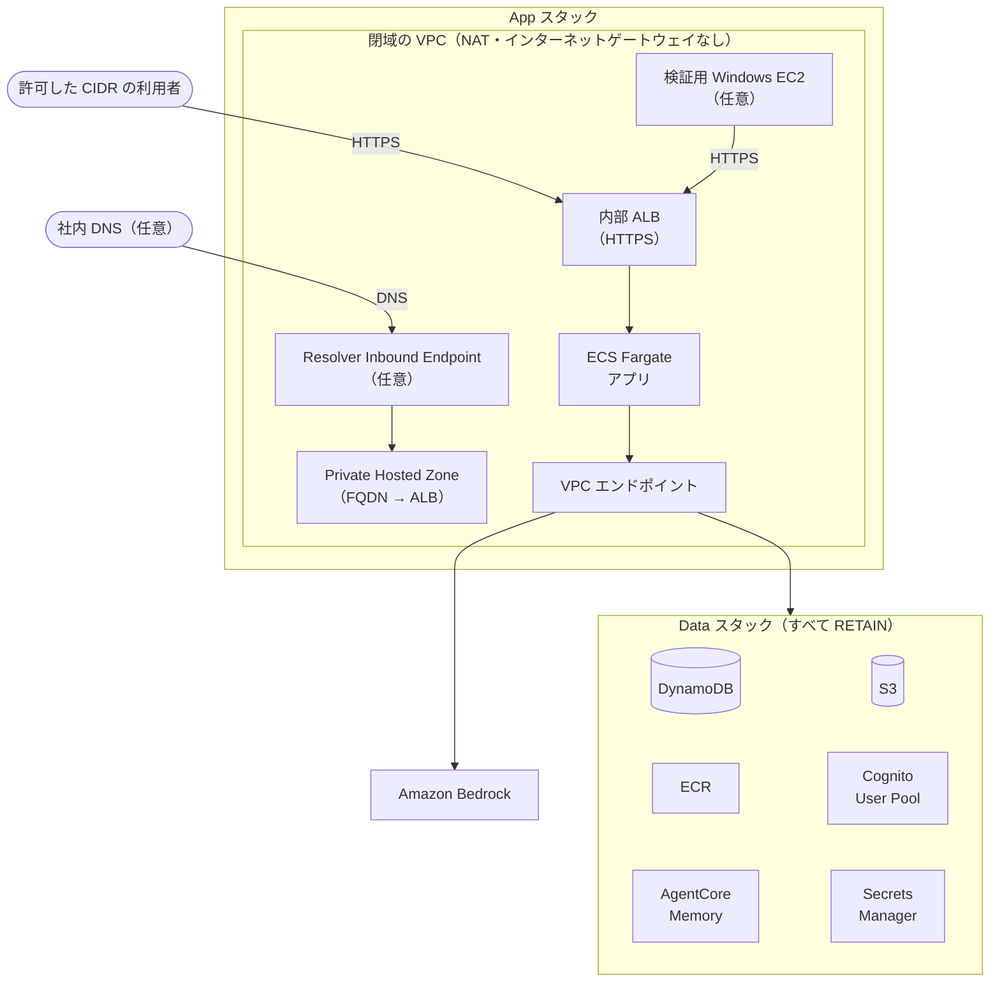

# 閉域構成ガイド

インターネットへ出る経路を持たない VPC の中で、AI ペルソナシステムを動かす構成（Stage `AIPersonaDevClosed`）のデプロイと使い方です。公開構成のデプロイは [CDK デプロイガイド](../cdk/README.md) を参照してください。

## 構成



利用者は閉域の VPC の中（許可した CIDR か検証用 EC2）から、指定した FQDN で内部 ALB へ HTTPS で届きます。アプリは AWS のサービスへ VPC エンドポイントだけを通って届き、外へ出る経路はありません。社内のネットワークから FQDN を引くときは、Resolver Inbound Endpoint へ社内 DNS から転送します。ログインは Cognito の Managed Login ではなく、アプリ自身のログイン画面で行います。

| スタック | 中身 |
|---|---|
| `AIPersonaDevClosed-Data` | 公開構成と同じ Data スタック（テーブル・S3・ECR・AgentCore Memory・鍵・User Pool。すべて RETAIN） |
| `AIPersonaDevClosed-App` | 閉域の VPC・VPC エンドポイント・Private Hosted Zone・内部 ALB・ECS Fargate・検証用 EC2（任意）・Resolver Inbound Endpoint（任意） |

閉域構成は **東京リージョン（`ap-northeast-1`）だけ** で使えます。ほかのリージョンを指定すると、デプロイの前にエラーになります。

公開構成（Stage `AIPersonaDev`）と同じアカウント・同じリージョンに並べて置けます。スタック・テーブル・User Pool・VPC はすべて別で、閉域の作業は公開構成に影響しません。

## 閉域で使えない機能

インターネットへ出る次の機能は、閉域では使えません。画面からも選択肢が消えます。

- **Hugging Face からの Nemotron の取得**: 代わりに、事前に S3 に置いたファイルを使います（下の「[Nemotron のデータを置く](#nemotron-のデータを置く)」）
- **データ分析エージェント（Data Agent）連携**
- **追加のペルソナのモデル**（Bedrock Mantle 経由の GPT・Gemma）

## 事前の準備

### 証明書

内部 ALB の HTTPS には、Data・App と同じリージョンの ACM の証明書が要ります。社内の CA の証明書があれば、それを ACM にインポートします。

検証だけなら、自己署名の証明書を使えます（ブラウザの警告は、検証のときだけ受け入れてください）。証明書と秘密鍵はリポジトリの外に作ります（リポジトリの中に置くと、`deploy.sh` が未コミットの変更として止まります）。

```bash
FQDN=ai-persona.example.internal
CERT_DIR=~/closed-cert
mkdir -p "$CERT_DIR"
openssl req -x509 -newkey rsa:2048 -nodes -days 365 \
  -keyout "$CERT_DIR/closed-alb.key" -out "$CERT_DIR/closed-alb.crt" \
  -subj "/CN=${FQDN}" -addext "subjectAltName=DNS:${FQDN}"
CERT_ARN=$(aws acm import-certificate --region ap-northeast-1 \
  --certificate "fileb://$CERT_DIR/closed-alb.crt" --private-key "fileb://$CERT_DIR/closed-alb.key" \
  --query CertificateArn --output text)
rm "$CERT_DIR/closed-alb.key"
echo "$CERT_ARN"
```

表示された ARN を `--certificate-arn` に渡します。秘密鍵はインポートしたら消します（上の `rm`）。

### Nemotron のデータを置く

マスアンケートで Nemotron を使う場合は、インターネットにつながる端末で Parquet を作り、閉域のアプリのバケットに置きます。デプロイのあとでも構いません。

1. インターネットにつながる端末（リポジトリを取得して `uv sync` した手元など）で Parquet を作る

   ```bash
   uv run python scripts/export_nemotron_parquet.py --output ./nemotron-personas-japan.parquet
   ```

2. 閉域のアプリのバケットを探す。S3 のコンソールで `aipersonadevclosed-data-uploadbucket` を検索すると見つかります
3. 手元の PC のブラウザで S3 のコンソールを開き、バケットの `persona-dataset/` フォルダ（なければ作る）に `nemotron-personas-japan.parquet` をアップロードする。設定は既定のままで構いません。ファイルは 1 GB を超えるため、CloudShell からはアップロードできません。AWS CLI を使える PC なら、次のコマンドでも置けます

   ```bash
   aws s3 cp ./nemotron-personas-japan.parquet s3://<バケット名>/persona-dataset/nemotron-personas-japan.parquet
   ```

4. アプリのペルソナデータ画面で「配置済み」とデータサイズが出ることを確かめる

置き場所を変えたいときは、`persona-dataset/nemotron/` の下のキー（例: `persona-dataset/nemotron/nemotron-v2.parquet`）に置き、`--nemotron-dataset-key <キー>` を付けてデプロイし直します。`candidates/`・`persona-dataset/custom/`・`persona-dataset/temp/` の下は使えません。

## デプロイ

CloudShell で次を実行します（前提は公開構成と同じで、作業ツリーに未コミットの変更がないこと）。

```bash
./deploy.sh --closed \
  --certificate-arn arn:aws:acm:ap-northeast-1:<アカウント>:certificate/<ID> \
  --domain-name ai-persona.example.internal \
  --create-test-environment
```

最後に、アプリの URL（`https://<FQDN>`）と、最初の admin を作るコマンド、次回の再デプロイに使うコマンドが表示されます。

| 引数 | 説明 |
|---|---|
| `--certificate-arn <ARN>` | 必須。内部 ALB の証明書 |
| `--domain-name <FQDN>` | 必須。利用者が開く名前（例 `ai-persona.example.internal`）。小文字で、ラベルを 2 つ以上 |
| `--create-test-environment` | 検証用の Windows EC2 を作る |
| `--allowed-cidrs <CIDR,...>` | ALB に届いてよい利用者の CIDR（カンマ区切り） |
| `--endpoint-az-count <1\|2>` | VPC エンドポイントを置く AZ の数（下の「[エンドポイントの AZ の数](#エンドポイントの-az-の数)」） |
| `--create-resolver-endpoint` / `--resolver-allowed-cidrs <CIDR,...>` | 社内 DNS から名前を引けるようにする（下の「[社内のネットワークから使う](#社内のネットワークから使う)」） |
| `--remove-resolver-endpoint` | 作った Resolver を消す |
| `--nemotron-dataset-key <キー>` | Nemotron のファイルを既定と違う場所に置いたとき |
| `--inference-scope jp` | 推論を国内に限る（[CDK デプロイガイドの「推論の範囲」](../cdk/README.md#推論の範囲inferencescope)） |
| `--image-tag <タグ>` | 前の版に戻す（ほかの引数は前と同じにする） |
| `--restart-app` | 秘密の値を書き換えたあと、タスクを入れ替える（`./deploy.sh --closed --restart-app`） |

`--allowed-cidrs` と `--create-test-environment` のどちらかが要ります（どちらもないと、誰も ALB に届かないため）。

### 再デプロイの注意

再デプロイでは、**前と同じ引数を渡してください。** 渡し忘れると、検証用 EC2・許可した CIDR・Resolver が消えたり、AZ の数が戻ったりします。前回の最後に表示されたコマンドを使うのが確実です。

Resolver とエンドポイントの AZ の数は、`deploy.sh` が今の環境と比べます。Resolver があるのに Resolver の引数がないときと、エンドポイントが 2 AZ なのに `--endpoint-az-count` がないときは、AWS を変える前に止まって、付けるべき引数を案内します。

## 検証用 EC2 から使う

`--create-test-environment` を付けると、閉域のサブネットに Windows Server 2022（日本語）の EC2 を 1 台作ります。Systems Manager の Fleet Manager のリモートデスクトップで入ります。

1. 接続に使うキーペアの秘密鍵を取り出す

   ```bash
   aws ec2 describe-instances --region ap-northeast-1 \
     --filters Name=tag:aws:cloudformation:stack-name,Values=AIPersonaDevClosed-App \
               Name=instance-state-name,Values=pending,running,stopping,stopped \
     --query 'Reservations[].Instances[].[InstanceId,KeyName]' --output text
   KEY_PAIR_ID=$(aws ec2 describe-key-pairs --region ap-northeast-1 --key-names <KeyName> \
     --query 'KeyPairs[0].KeyPairId' --output text)
   aws ssm get-parameter --region ap-northeast-1 --name "/ec2/keypair/${KEY_PAIR_ID}" \
     --with-decryption --query Parameter.Value --output text > closed-rdp.pem
   ```

2. AWS コンソールの Systems Manager →「Fleet Manager」でインスタンスを選び、「ノードアクション」→「接続」→「リモートデスクトップで接続」を開く。認証の種類に「キーペア」を選び、`closed-rdp.pem` を渡して接続する
3. インスタンスの中のブラウザで `https://<FQDN>/login` を開いてログインする
4. 使い終えた `closed-rdp.pem` は手元から消す

使わない間は EC2 を止めておけます（止めている間はインスタンスの料金がかかりません）。要らなくなったら、`--create-test-environment` を付けずにデプロイし直すと消えます（そのときは `--allowed-cidrs` が要ります）。

## 利用者の管理

利用者・ロール・グループの管理は、公開構成と同じく [利用者・ロール・グループの管理](user_management.md) の手順で行います。閉域構成では、次の点が違います。

- **User Pool:** CloudFormation の `AIPersonaDevClosed-Data` スタックの出力 `UserPoolId` で確かめます。AWS CLI では、`USER_POOL_ID` を求めるコマンドのスタック名を `AIPersonaDevClosed-Data` にします
- **ログイン:** Cognito のログイン画面ではなく、アプリ自身のログイン画面を使います
- **パスワードの回復:** メールでのパスワードの再設定はできません（下の「[パスワードを忘れたとき](#パスワードを忘れたとき)」）
- **ログインの試行回数:** パスワードを続けて間違えると、しばらくログインできなくなります（画面に「試行回数が上限に達しました」と出ます）

### 利用者を作る

一時パスワードを付けて利用者を作り、本人に別の経路で伝えます。本人は初回ログインで「パスワードの設定」画面に移り、新しいパスワードを設定します。一時パスワードは 8 文字以上で、大文字・小文字・数字・記号を含めます。

**コンソールで:** [利用者・ロール・グループの管理の「利用者を作る」](user_management.md#利用者を作る) の手順で、次の 2 か所だけを変えます。

- 招待メッセージは「招待を送信しない」を選ぶ
- パスワードは「パスワードの設定」を選び、一時パスワードを入れる

**AWS CLI で:**

```bash
aws cognito-idp admin-create-user --region "$REGION" --user-pool-id "$USER_POOL_ID" \
  --username <メールアドレス> \
  --user-attributes Name=email,Value=<メールアドレス> Name=email_verified,Value=true \
  --temporary-password '<一時パスワード>' --message-action SUPPRESS
```

一時パスワードをコマンドの履歴に残さないよう注意してください。続けて、公開構成と同じ手順でロールを付けます。

### パスワードを忘れたとき

管理者が AWS CLI で一時パスワードを設定し直します。本人は次のログインで新しいパスワードを設定します。

```bash
aws cognito-idp admin-set-user-password --region "$REGION" --user-pool-id "$USER_POOL_ID" \
  --username <メールアドレス> --password '<一時パスワード>' --no-permanent
```

コンソールの「パスワードをリセット」は使わないでください。リセットした利用者は、閉域のログイン画面から先へ進めなくなります。

## 社内のネットワークから使う

Direct Connect や VPN で閉域の VPC とつないだ社内の端末から使う場合の手順です。

1. 利用者の CIDR と社内 DNS の CIDR を渡してデプロイする

   ```bash
   ./deploy.sh --closed --certificate-arn <ARN> --domain-name <FQDN> \
     --allowed-cidrs <利用者の CIDR> \
     --create-resolver-endpoint --resolver-allowed-cidrs <社内 DNS の CIDR>
   ```

2. Resolver の IP（2 つ）を調べる

   ```bash
   RESOLVER_ID=$(aws cloudformation describe-stacks --stack-name AIPersonaDevClosed-App --region ap-northeast-1 \
     --query "Stacks[0].Outputs[?OutputKey=='ResolverEndpointId'].OutputValue" --output text)
   aws route53resolver list-resolver-endpoint-ip-addresses --region ap-northeast-1 \
     --resolver-endpoint-id "${RESOLVER_ID}" --query 'IpAddresses[].Ip' --output text
   ```

3. 社内 DNS に、FQDN のゾーンを手順 2 の IP へ転送する条件付きフォワーダーを足す

Resolver を作り直すと IP が変わります。そのときは手順 2 で調べ直し、社内 DNS の転送先を直してください。Resolver をやめるときは `--remove-resolver-endpoint` を付けてデプロイします。

## エンドポイントの AZ の数

VPC エンドポイントを置く AZ の数を `--endpoint-az-count` で選びます。エンドポイントの料金は AZ の数に比例します。

| AZ の数 | 向いている使い方 |
|---|---|
| `1`（dev の既定） | 検証。費用はおよそ半分ですが、その AZ が止まるとアプリも止まります |
| `2` | 止まると困る使い方 |

## 大きなファイルのダウンロード

閉域では、アバター・添付・アンケート結果の CSV などのファイルを、アプリを通して配ります。200 MiB を超えるアンケート結果の CSV は画面からダウンロードできません（「ファイルが大きすぎるため表示できません」と出ます）。その場合は、管理者が検証用 EC2 などから S3 の `survey-results/<アンケートの ID>/results.csv` を取り出してください。

```bash
aws s3 cp s3://<バケット名>/survey-results/<アンケートの ID>/results.csv . --region ap-northeast-1
```

## 月額の目安

閉域構成で動かしたときの、全体の月額の目安です。利用量の前提（利用者 10 名、議論 60 回/月など）は [AWS コスト試算例](cost_estimation.md) と同じで、東京リージョン・2026-10-28 時点の単価です。

| 構成 | 月額の目安 |
|---|---|
| 最小（エンドポイントの AZ の数 1） | 約 210 USD |
| 最小 ＋ 検証用 EC2 | 約 310 USD |
| エンドポイントの AZ の数 2 | 約 310 USD |
| エンドポイントの AZ の数 2 ＋ 検証用 EC2 | 約 440 USD |

社内 DNS から使う（Resolver を作る）ときは、どの構成でも約 183 USD 増えます。

**内訳（最小の構成）**

| 項目 | 月額 |
|---|---|
| VPC エンドポイント（10 種、AZ の数 1） | 約 102 USD |
| ECS Fargate（1 vCPU、4 GB） | 約 53 USD |
| Amazon Bedrock | 約 24 USD |
| 内部 ALB | 約 20 USD |
| その他（AgentCore Memory、ECR、S3、DynamoDB、Secrets Manager、KMS） | 約 8 USD |

- 公開構成（約 152 USD）と比べると、NAT Gateway（約 47 USD）がなくなり、VPC エンドポイントの費用が増えます
- エンドポイントの費用は AZ の数に比例します。AZ の数 2 では約 204 USD です
- 検証用 EC2 は、EC2 本体（Windows、t3.medium で約 70 USD）と、そのためのエンドポイント 3 種（AZ の数 1 で約 31 USD、2 で約 61 USD）がかかります。EC2 は止めておけば本体の料金はかかりません
- ほかに、エンドポイントのデータ処理料（1 GB あたり 0.01 USD）と Resolver の問い合わせの料金がかかります。料金は変わることがあるため、デプロイの前に料金ページで確かめてください
